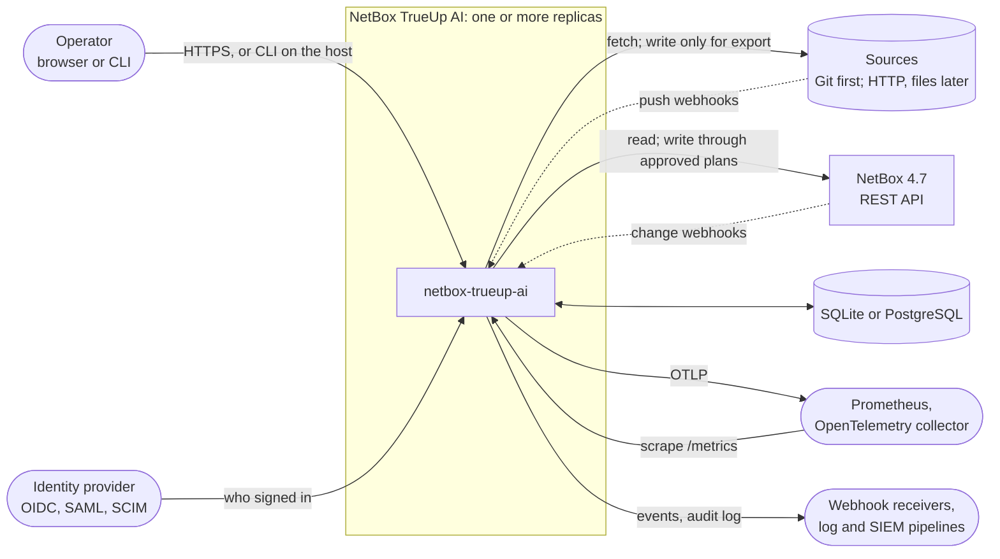
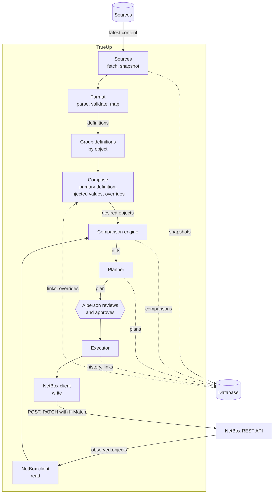
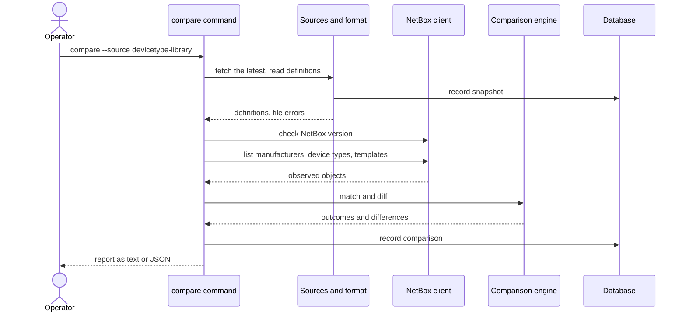
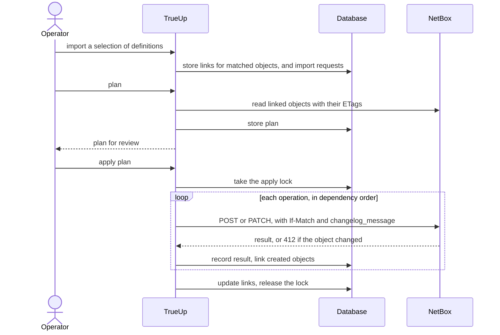
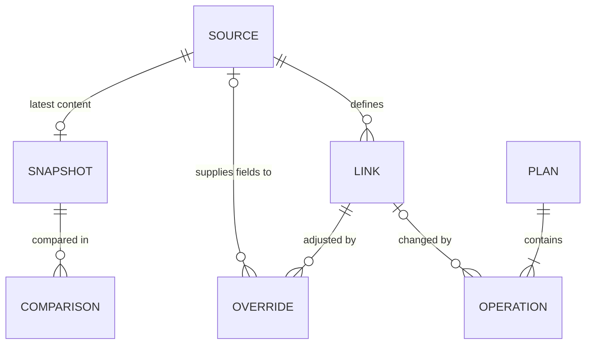
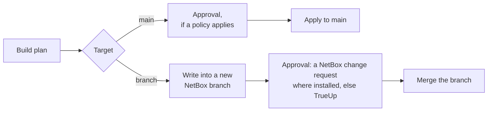
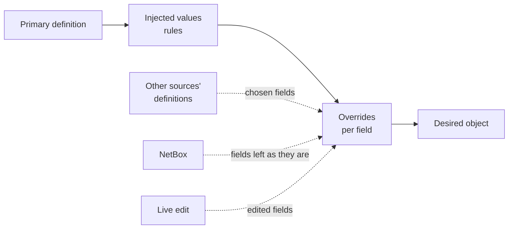
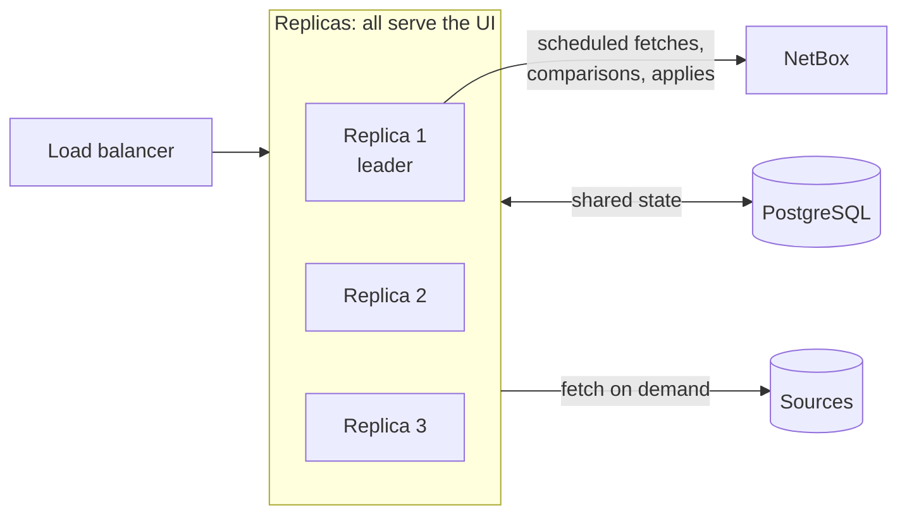
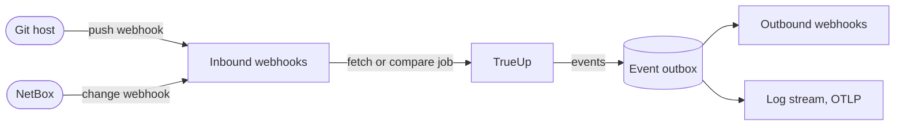
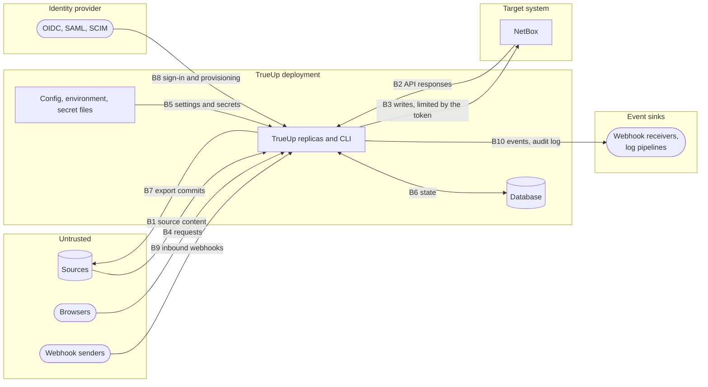

# Architecture

This document describes how NetBox TrueUp AI is designed: its components, how data moves between them, and where the trust boundaries are. Read it before you build or change a component.

**Status:** design. Apart from the version stub, none of this exists yet. Each component below names the milestone that builds it; [roadmap.md](roadmap.md) lists the steps. When the code and this document disagree, fix one of them in the same pull request. Decisions that had real alternatives are recorded as [ADRs](adr/), and this document links to them instead of repeating their reasoning.

## Principles

1. **TrueUp manages only what it is told to.** A NetBox object is managed only after a person imports a definition and TrueUp links the two. Unlinked objects, and fields a definition doesn't set, are left alone. TrueUp never deletes anything on its own. ([ADR 0006](adr/0006-manage-only-linked-objects.md))
2. **Only the latest version counts.** TrueUp reads the latest content of each source (for Git, the latest commit on the configured branch or tag) and never goes back to an older version. It records which version it read, so you can see what each comparison and sync was based on. ([ADR 0009](adr/0009-source-kinds-and-format-adapters.md))
3. **NetBox's rules, not ours.** Matching, defaults and field comparison follow what NetBox 4.7 does, taken from its source code and API schema. Each rule cites where it came from. ([ADR 0003](adr/0003-initial-netbox-target.md), [ADR 0008](adr/0008-describe-object-types-with-specs.md))
4. **Compare, plan, then write.** Nothing reaches NetBox's main data except from a stored plan that a person approved; a plan can be written into a NetBox branch first, for review. Teams that need change management can require approval by others, tie each plan to an external change, and send plans through NetBox branches; a single user isn't slowed down by any of it. ([ADR 0010](adr/0010-write-through-reviewed-plans.md), [ADR 0016](adr/0016-permissions-and-approval-policies.md), [ADR 0017](adr/0017-netbox-branches.md))
5. **Every change has a name on it.** Every action in TrueUp, and every write to NetBox, is recorded with who did it, when, how and with what result, and can be streamed to other systems. ([ADR 0014](adr/0014-audit-every-action.md))
6. **Everything from outside is untrusted.** Source files, NetBox responses and browser input are validated before they are used. See [Trust boundaries](#trust-boundaries).
7. **One binary at any scale.** The same binary runs as a CLI, as a single-node server on SQLite, or as a cluster of replicas on PostgreSQL.

## Extension points

TrueUp starts narrow and grows along three independent axes. Each axis has its own extension point, so growth on one doesn't require changes to the others, or to the comparison engine, planner or UI.

| Axis | First | Later | Extension point |
| --- | --- | --- | --- |
| [Source kinds](#sources) | Git | HTTP, local files, others | A source kind: fetch content and produce snapshots |
| [Formats](#formats-and-validation) | devicetype-library | Other layouts, such as a format for any NetBox object | A format adapter: turn the files in a snapshot into definitions |
| [Object types](#object-model-and-specs) | Manufacturers, device types and their component templates | Module types, module type profiles, module bay types, rack types, and more | A spec, plus mapping in each format that carries the type |

devicetype-library itself already spans several object types: about 12,400 device type, 2,000 module type and 150 rack type files. Module types refer to a module type profile by name, so profiles join with module types.

## Vocabulary

| Term | Meaning |
| --- | --- |
| Source | Where definitions come from: a kind, a location, a format, and the paths to read. For example, devicetype-library's Git repository at `master`. |
| Source kind | How a source's content is fetched: Git first, then HTTP, local files and others. |
| Snapshot | A source's latest content, read at a single version (a commit for Git, a content digest for other kinds) so that one run never mixes files from different versions. TrueUp keeps only the latest snapshot of each source. |
| Format | The layout of a source's files and how they map to NetBox objects. The first format is devicetype-library's. |
| Object type | A NetBox model TrueUp understands, such as `dcim.devicetype` or `dcim.interfacetemplate`. |
| Spec | The declarative description of an object type: endpoint, fields and their semantics, uniqueness rules, dependencies. |
| Definition | One object as one source describes it, such as the device type in `device-types/Dell/PowerEdge-R670.yaml`. Several sources can define the same object. |
| Primary definition | What a managed object follows, chosen when it is imported: one source's definition, or NetBox, which means "leave it as it is" apart from its overrides. |
| Override | A choice, for one field of one object, to take its value from somewhere other than the primary definition: another source, NetBox ("leave it"), or a local edit stored in TrueUp's database. |
| Desired object | The primary definition after injected values and overrides are applied: what TrueUp wants NetBox to hold. |
| Observed object | The object as NetBox returns it, normalized through the same spec. |
| Side-by-side comparison | Every version of one object in columns, field by field: each source's definition, NetBox's object, the live edit and the desired object. |
| Import | A person's request to bring an object under management, following a chosen definition: link it to the matching NetBox object, or create one. |
| Link | The record that a NetBox object (object type and ID) is managed from its primary definition (source and path). |
| Plan | A stored, ordered list of writes that would bring linked NetBox objects in line with their desired objects. |
| Approval policy | An optional rule, for some scope of objects, that a plan needs approval from particular people before it reaches NetBox. Off by default. |
| Change reference | The ticket for the external change a plan belongs to, by URL or by ticket number. |
| Branch | A NetBox branch, from the netbox-branching plugin, that a plan can be written into and reviewed in before it is merged. |
| Audit event | The record of one action: who did it, what, when, how and with what result. |

## System context



## Components

| Component | Responsibility | Planned package | Milestone |
| --- | --- | --- | --- |
| [Sources](#sources) | Fetch content, record snapshots, read the files in a snapshot | `internal/source/...` | M1 (Git), M9 (more kinds) |
| [Formats](#formats-and-validation) | Parse and validate source files, and map them to definitions | `internal/format/...` | M1 |
| [Object model and specs](#object-model-and-specs) | Generic objects, and a spec for each object type | `internal/model/...` | M1 |
| [Comparison engine](#comparison-engine) | Group definitions across sources, match them to NetBox, and compare any number of versions of an object | `internal/compare` | M1 |
| [NetBox client](#netbox-client) | REST access: reads in M1, writes in M2 | `internal/netbox` | M1, M2 |
| [Storage](#storage) | Database access and migrations | `internal/store/...` | M1 |
| [Configuration](#configuration) | Declared and runtime settings | `internal/config` | M1 |
| [Linking, planning and applying](#linking-planning-and-applying-m2) | Links; building, storing and applying plans | `internal/sync` | M2 |
| [Change management](#change-management) | Change references and NetBox branches; approval policies that can be turned on | `internal/sync`, `internal/policy` | M2, M4 |
| [Identity, access and audit](#identity-access-and-audit) | Sign-in, provisioning, scoped permissions, and an append-only record of every action | `internal/auth`, `internal/policy`, `internal/audit` | M2 (audit), M3 (sign-in), M4 (SAML, SCIM, scopes) |
| [Web UI](#web-ui-m3) | Browse, compare side by side, edit live, import, review and apply | `internal/web` | M3 |
| [Overrides and injected values](#overrides-and-injected-values-m5) | Compose desired objects from the primary definition, other sources, NetBox and edits | `internal/override` | M5 |
| [High availability](#high-availability-m6) | Jobs, schedules, leader election | `internal/cluster` | M6 |
| [Observability](#observability) | Logs, metrics for Prometheus and OpenTelemetry, traces | `internal/telemetry` | M1 (logs), M6 |
| [Events and integrations](#events-and-integrations-m7) | Inbound webhooks, outbound webhooks, streaming the audit log out | `internal/events`, `internal/webhook` | M7 |

### Data flow



In milestone 1 the flow stops at the comparison engine: TrueUp reads, compares and reports, and records what it compared.



Milestone 2 adds importing, planning and applying:



## Sources

A source is where definitions come from. Each source has a **kind**, which decides how its content is fetched, and a **format**, which decides how its files are read ([ADR 0009](adr/0009-source-kinds-and-format-adapters.md)). The two are independent: the devicetype-library format reads the same files whether they come from Git, over HTTP or from a local directory.

| Kind | Fetches | Snapshot version | Milestone |
| --- | --- | --- | --- |
| Git | The latest commit on a branch or tag of a repository | The commit | M1 |
| HTTP | A file or an archive at a URL | A digest of the content | M9 |
| Local files | A directory on the server | A digest of the content | M9 |
| Others, such as a catalog API | Defined by the kind | Defined by the kind | When needed |

A source is configured with a name, a kind, a location (a repository URL, a URL or a directory), settings specific to its kind such as a Git branch or tag, a format, include and exclude path patterns, a reference to its credentials, and later a fetch schedule.

Every kind does the same job behind one interface:

- **Latest only.** A fetch reads the source's latest content and replaces the previous snapshot. Older versions are never read again, for comparing, planning or display.
- **Snapshots.** A fetch records the source's version, time and outcome, and the files the snapshot contains, each with its path, size and digest. Comparisons, plans and links record the version they used, so you can see what they were based on. Nothing outside the source layer knows which kind produced a snapshot.
- **Limits and paths.** Limits on file size, file count and path patterns are applied before any file is parsed. Paths are normalized and confined to the snapshot: no absolute paths and no `..`, and symbolic links are skipped.

### Git sources (M1)

- **Fetching** uses go-git, so neither the binary nor the container image needs a `git` executable. Each node keeps a cache in its data directory: one bare, shallow, single-branch clone per source. The cache is disposable; deleting it costs a re-fetch.
- **Versions.** A fetch resolves the configured branch or tag to its latest commit, which becomes the snapshot's version.
- **Reading** walks the commit's tree in Git's object store. Nothing is checked out to disk, so hooks, filters and submodules never come into play, and a symlink is just a tree entry that TrueUp skips.
- **Known risk: repository size.** Elevation images make up about 1 GB of devicetype-library's tree, and a depth-1 clone transferred about 830 MB in October 2026. go-git can fetch with a partial-clone filter, but it can't fetch skipped objects later, so TrueUp must never need them. The milestone 1 Git step measures time, disk and peak memory for this clone, and picks a mitigation if needed: for example a `blob:limit` filter that skips large blobs but keeps YAML, or an optional system `git`. The result is recorded in an ADR.

### Writing to sources (M10)

A Git source can be marked writable. Exporting a NetBox object writes its definition, in the source's format, to a branch, and links the object to the new file. Write credentials are separate from read credentials, and normal syncing never needs them. Other kinds may support writing later.

## Formats and validation

A format turns the files in a snapshot into definitions, without knowing which source kind produced them. Each format is an adapter in its own package. The first is devicetype-library's ([ADR 0009](adr/0009-source-kinds-and-format-adapters.md)), starting with its device types; its module and rack types follow.

For each file, the adapter:

1. parses the YAML with `go.yaml.in/yaml/v3` into a node tree, rejecting duplicate keys and enforcing limits on nesting depth and alias expansion;
2. validates it against the format's JSON schema. For devicetype-library these are the library's own `schema/*.json` files from the same snapshot, compiled with remote references turned off;
3. maps it to definitions in the object model, converting the format's layout to NetBox's (see below);
4. validates the definitions against their specs: types, lengths, choices and required fields as NetBox 4.7 defines them.

A file that fails any step is reported with its path, line and column, and skipped. It doesn't stop the rest of the snapshot.

The mapping step is where a format and NetBox differ. For devicetype-library:

- `manufacturer` is a name. It becomes a reference to a `dcim.manufacturer`, matched by name as NetBox's own import does (`DeviceTypeImportForm` in `dcim/forms/bulk_import.py`), and resolved to an ID when planning.
- Manufacturers are objects in their own right, not just references. The library has no manufacturer files, so the adapter derives a manufacturer definition for each manufacturer the library names: the name, and a slug made the way NetBox's UI makes one. A derived value like that slug is used only when TrueUp creates the object; for an existing manufacturer it isn't managed, so importing never rewrites a slug other tools rely on. Manufacturers are then listed, compared, imported and synced like any other object, and other sources can define them more fully.
- Component lists use hyphenated keys (`console-ports`, `front-ports`). They become child objects of the device type.
- `port-mappings` is a separate list, but NetBox 4.7's REST API takes a front port template's mappings as a nested `rear_ports` list (`FrontPortTemplateSerializer` in `dcim/api/serializers_/devicetype_components.py`), and replaces the whole set whenever that list is sent (`PortSerializer` in `dcim/api/serializers_/base.py`). The adapter folds each mapping into its front port.
- `is_powered` is a hint for the library's own tests, and `front_image` and `rear_image` are booleans saying an image file exists. None of them is a NetBox field. They are kept as metadata and never sent to NetBox. NetBox's own YAML import ignores them too, because `DeviceTypeImportForm` doesn't list them.
- The library doesn't carry some NetBox 4.7 fields, such as `end_of_life`, `cooling_method`, `exclude_from_utilization` and `default_platform`. Since TrueUp manages only the fields a definition sets, those stay under NetBox users' control unless an override or injected value sets them.

devicetype-library holds about 12,400 device type files from about 370 manufacturers. A source's include patterns limit what is read.

## Object model and specs

TrueUp handles NetBox objects generically: an object is an object type plus a map of field values. A value is a string, integer, decimal, boolean, date, choice, reference, set or child collection. What each object type means lives in its spec ([ADR 0008](adr/0008-describe-object-types-with-specs.md)), which declares:

- the REST endpoint, and the object types it depends on (a device type needs its manufacturer);
- the object's identity: the one uniqueness rule that says two definitions, or a definition and a NetBox object, are the same thing. For device types that is manufacturer and model; for manufacturers, the name;
- the uniqueness rules NetBox enforces, from the model's fields and `Meta.constraints`: `name` and `slug` each for manufacturers (`OrganizationalModel` in `netbox/models/__init__.py`), `(manufacturer, model)` and `(manufacturer, slug)` for device types (`dcim/models/devices.py`), `(device_type, name)` for most component templates, and `(device_type, parent, name)` for inventory item templates (`dcim/models/device_component_templates.py`). Specs also record where a rule has gaps. The inventory item rule doesn't cover top-level items: their `parent` is null and the constraint doesn't set `nulls_distinct=False`, so NetBox accepts two top-level items with the same name;
- each field's type, whether it is writable, nullable or required, its default, and how NetBox normalizes it;
- child collections, such as the component templates on a device type, and the key that identifies a child within its parent;
- the write shape, where it differs from what the API returns, as with front port mappings above;
- citations of the NetBox files and classes the spec follows, at the pinned version.

A contract test checks every spec against the OpenAPI schema (`/api/schema/`) of the target NetBox: the fields exist, writability and types agree, and choice values match. Comparison, overrides, planning, the UI's diff views and the permission-set generator all work from specs. Supporting a new object type therefore means writing its spec and tests, not new comparison code. The `add-netbox-object` project skill ([tooling.md §1.4](tooling.md#14-project-skills-we-will-write-these)) will hold the checklist.

Definitions refer to other objects by natural key, such as a manufacturer's name. References are resolved to NetBox IDs when planning.

## Comparison engine

The comparison engine is pure: it takes objects and specs and returns differences, with no I/O. It is fuzzed, and it is the part of the project most worth getting exactly right.

**Grouping across sources.** Several sources can define the same object: a Git source and a file source might both define a Dell PowerEdge R710. Definitions are grouped into objects by their spec's identity rule: two device type definitions with the same manufacturer and model describe the same object, and a difference in slug shows as a difference. Definitions that share only another unique value, such as a slug with different models, are different objects that NetBox couldn't hold together, so they are reported as a conflict for a person to resolve. If one source defines an object twice, that source reports a conflict too. Grouping works the same for any number of sources.

**Matching NetBox.** A linked object is compared with the NetBox object its link names, by ID. For an unlinked object, the engine looks for the NetBox objects its definitions would collide with under NetBox's uniqueness rules, if they were created. Each object gets one outcome:

| Outcome | Meaning |
| --- | --- |
| Candidate | The identity rule matches one NetBox object, and no other uniqueness rule collides with a different object. For example, the model matches and the slug differs, which shows as a difference. Importing links to it. |
| Absent | Nothing matches. Importing creates the object. |
| Conflict | Creating the object would collide with a NetBox object that isn't its match: the model matches one device type and the slug another, or only the slug matches. A person decides. |
| Linked | Compared with the linked object (from M2). |
| Orphaned | Linked, but the primary definition is no longer in its source (from M2). |
| Missing | Linked, but the NetBox object has been deleted (from M2). |

**Side by side.** The engine compares any number of versions of one object at once: each source's definition, NetBox's object, the live edit in the UI, and the desired object. The result is a table with a row for every field path any version sets, including children, and a column for each version, marking where the versions differ. This is the view people use to decide which source an object follows and which fields to override. A plan's diff, desired object against NetBox, is the two-column case.

**Field ownership.** When planning, only the fields the desired object sets are compared. A definition that leaves a field out doesn't manage it, which matches NetBox's own import: when a record carries an `id`, only the fields present in it are updated (`_process_import_records` in `netbox/views/generic/bulk_views.py`). Defaults matter only when an object is created; NetBox applies them, and the plan shows them so the reviewer sees what will be created.

**Normalization.** Every version goes through the same spec, so values are compared as NetBox stores them, not as they happen to be written. Examples from NetBox 4.7.2:

- Choice fields read back as `{value, label}`, or `null` when blank (`ChoiceField.to_representation` in `netbox/api/fields.py`). TrueUp compares the value, and treats blank and null alike.
- Decimals are compared as decimals at the field's precision, so `u_height: 1` equals `1.0`. `u_height` is a `DecimalField` with one decimal place, and the API returns decimals as JSON numbers (`COERCE_DECIMAL_TO_STRING: False` in `netbox/settings.py`).
- Strings are compared after trimming leading and trailing whitespace, as Django REST Framework's `CharField` does to input.
- References are compared by NetBox ID once resolved. Sets, such as port mappings, ignore order.
- Children are matched by their key within the parent. If a key matches more than one child in NetBox, which NetBox allows for top-level inventory items, that child is reported as a conflict.

**Output.** For each object: its outcome, the side-by-side table, and for planning the differences between the desired object and NetBox (field changes, children to add or change, children present only in NetBox, which are reported but never removed, and the fields left unmanaged). The CLI prints text or JSON, and the UI renders the same structure.

## NetBox client

TrueUp uses its own thin REST client built on `net/http` (tooling.md §3.1). An ADR confirms it after the milestone 1 prototype. The client covers exactly what TrueUp needs:

- **Version check.** It calls `GET /api/status/` on connect, and refuses to work with a NetBox version TrueUp doesn't support ([ADR 0003](adr/0003-initial-netbox-target.md)).
- **Authentication.** v2 tokens (`Authorization: Bearer nbt_…`). v1 tokens still work on 4.7 but are deprecated and removed in NetBox 5.0, so TrueUp warns when one is used. The token is never logged, and request logging redacts the `Authorization` header.
- **Reads.** Cursor pagination (`?start=`) for full listings. Children are read with filters covering many parents per request, not one request per object, so read cost scales with the selection, not the library.
- **Writes (M2).** `POST` and `PATCH` with a `changelog_message`, and `If-Match` on updates. Bulk creates send JSON arrays, which NetBox applies atomically, and NetBox 4.7's per-object bulk errors are mapped back to the operations that caused them. TrueUp never uses `?background=true`: NetBox runs those writes without the branch header, so they would land in main ([Change management](#change-management)).
- **Branches (M2).** Where the netbox-branching plugin (1.2.x for NetBox 4.7) is installed: creating a branch and waiting until it is ready, reading and writing in it with the `X-NetBox-Branch` header, merging it, and following the asynchronous jobs that sync and merge run as. TrueUp checks for the plugin when it connects.
- **Resilience.** A timeout on every request, a cap on concurrent requests, and a response size limit. Reads are retried with backoff and jitter, honouring `Retry-After` on 429 and 503 responses. Writes are never retried automatically: a failed or uncertain write ends its operation, and the executor decides what happens next.
- **TLS.** The system trust store, plus an optional CA bundle for private CAs.

The client speaks JSON, and the object model owns the types. In milestone 1 the client has no write methods at all.

## Storage

TrueUp keeps its state in SQLite on a single node, or in PostgreSQL for high availability ([ADR 0011](adr/0011-store-state-with-sqlc-and-goose.md)). Queries are plain SQL compiled by sqlc, with one query set per engine behind a shared Go interface. Migrations are goose files embedded in the binary, applied at startup under a lock or by the `migrate` command. One test suite runs against both engines.



| Data | Purpose | Milestone |
| --- | --- | --- |
| Sources and snapshots | Each source's latest fetch: version, time, outcome and file list | M1 |
| Comparisons | The latest comparison of each definition: when, against which source version and NetBox, and the result | M1 |
| Links | Provenance: the primary definition (source and file) each managed NetBox object follows, who linked it and when, and the source version and time of its last sync | M2 |
| Import requests | Definitions a person asked to import that NetBox doesn't have yet | M2 |
| Plans and operations | Sync history: each plan, its change reference and NetBox branch, who approved and applied it, and each write with before and after values | M2 |
| Audit events | Every action: who, what, when, how and the result. Append-only | M2, with UI actions from M3 |
| Users and sessions | Local accounts, single sign-on identities, users and groups provisioned through SCIM, and sessions shared across replicas | M3, M4 |
| Permissions and approval policies | Role grants on scopes, approval policies, and each approval or rejection | M3, M4 |
| Runtime settings | Settings edited in the UI | M3 |
| Overrides and injection rules | Per-field choices for each object (another source, NetBox, or an edited value), and rules that set fields across many objects | M5 |
| Jobs and leases | Scheduled work and leader election | M6 |
| Event outbox, webhook endpoints and deliveries | Events waiting to be sent, where they go, and each delivery attempt | M7 |

Not stored: source content, which is read from each node's cache of the latest snapshot, and NetBox state, which is read live. Plans keep the before and after values of the fields they change, for history.

Inside NetBox, the only mark TrueUp leaves is a changelog message on each write ([ADR 0007](adr/0007-provenance-and-changelog-messages.md)). TrueUp's database is the record of where each object came from.

To begin with, each deployment talks to one NetBox instance. Links and locks are keyed by NetBox instance so that more can be added later.

## Configuration

Settings come in two kinds ([ADR 0012](adr/0012-layered-configuration.md)):

- **Declared settings** come from command-line flags, then environment variables with the `TRUEUP_` prefix, then a YAML config file, then defaults. `database.url` becomes `TRUEUP_DATABASE_URL`. Secrets can be read from files, which suits Docker and Kubernetes secrets. Process settings, such as the listen address, database, data directory and logging, can only be declared, and changing them needs a restart.
- **Runtime settings**, such as sources, the NetBox connection, schedules and sync policies, can also be edited in the UI or CLI and are stored in the database. If a runtime setting is declared, the declared value wins and the UI shows it as read-only, so a config file kept in Git stays authoritative. The full order is therefore flags, environment, file, database, defaults.

Keys are snake_case, and each secret setting has a companion ending in `_file` that names a file to read the secret from. In the file below, `netbox.token_file` is that companion; in the environment it is `TRUEUP_NETBOX_TOKEN_FILE`. Milestone 1 has no UI, so everything is declared. For example:

```yaml
netbox:
  url: https://netbox.example.com
  token_file: /run/secrets/netbox-token
sources:
  - name: devicetype-library
    kind: git
    url: https://github.com/netbox-community/devicetype-library.git
    ref: master
    format: devicetype-library
    include: ["device-types/Juniper/**"]
```

Secrets are never logged or displayed, and `config show` redacts them. Until an ADR covers encrypting secrets entered in the UI, secrets come only from declarations.

## Linking, planning and applying (M2)

**Importing and linking.** A link records that a NetBox object (object type and ID) is managed from its primary definition (source and path). Links are created only when a person imports an object ([ADR 0006](adr/0006-manage-only-linked-objects.md)). Importing from a source makes that source's definition primary. A person can later switch the primary to another source's definition, or to NetBox, which leaves the object as it is apart from its overrides ([ADR 0013](adr/0013-compose-objects-across-sources.md)).

- If the object is a candidate, TrueUp links it to the matching NetBox object, and the next plan updates that object.
- If it is absent, the next plan creates the object, and TrueUp links it once the create succeeds. If a matching object has appeared by the time a plan is built, TrueUp links to it instead of creating a duplicate.
- A conflict needs a person to pick the NetBox object, or resolve the clash in NetBox first.

People can import in bulk by selection, for example every definition under `device-types/Juniper/`. This is how users choose what syncs. Unlinking stops management and leaves the NetBox object as it is.

Once linked, the object is addressed by its NetBox ID: the planner puts the ID into the desired object. A model or slug renamed upstream therefore updates the same NetBox object instead of creating a new one.

Prerequisites, such as the manufacturer a device type refers to, are looked up by natural key. An existing one is referred to, and left alone unless it was imported itself. A missing one is imported in the same plan from a source that defines it, so the reviewer sees it, and approving the plan links it like any other import. If no source defines it, the plan reports the objects that need it as blocked.

**Planning.** The planner takes the import requests and links, their desired and observed objects, and the comparison results, and builds a plan ([ADR 0010](adr/0010-write-through-reviewed-plans.md)):

- Operations run in dependency order, worked out from the references the specs declare: manufacturers, then device types, then component templates, each after the templates it refers to. Rear ports come before the front ports mapped to them, power ports before the power outlets that refer to them, and an interface after its parent and bridge interfaces. Inventory items come last, parents first, because they can refer to any other component.
- Creates send the fields the definition sets. Updates `PATCH` only the fields that differ.
- Deletes appear only when a person selects an orphaned object or component for removal.
- The plan records the version of each source it used, the digest of every file it used, and the ETag of every NetBox object it read.

Plans are stored, and nothing reaches NetBox's main data until the plan is approved. With approval policies off, the default, the person who applies a plan is its approver. With them on, the plan needs the approvals its policy asks for, and it may first be written into a NetBox branch so reviewers can see it there ([Change management](#change-management)).

**Applying.** The executor runs an approved plan:

- If any file the plan used has changed in its source since the plan was built, the plan is stale: nothing is written, and a new plan must be built and approved. TrueUp never writes an older version of a definition. Changes to files the plan didn't use, which are common in a busy repository like devicetype-library, don't make it stale.
- Updates send `If-Match` with the recorded ETag. If NetBox answers 412, the object changed after planning: the executor stops, marks the plan stale, and a new plan is built from fresh data.
- Every write carries a `changelog_message` identifying TrueUp, the source, the file, the source version, the plan, its change reference and the person who approved it ([ADR 0007](adr/0007-provenance-and-changelog-messages.md)). NetBox records TrueUp's service account as the user for every write, so the message is how NetBox's own history shows the person behind a change. NetBox stores at most 200 characters (`ObjectChange.message` in `core/models/change_logging.py`), and its API doesn't check the length (`ChangeLogMessageSerializer` in `netbox/api/serializers/features.py`), so TrueUp keeps every message within that limit itself. The fixed parts come first: TrueUp's marker, the plan number, the approver and a 12-character commit. The ticket and the file path share what is left, shortened if needed. The plan number leads to the full record in TrueUp.
- A write that fails, or whose outcome is unknown, such as a `POST` that timed out, is never retried blindly. The executor stops, re-reads NetBox and re-plans. Comparison is idempotent, so finished work shows up as in sync. A create that did go through shows up as a matching object, which the new plan links, and a prerequisite is found by its natural key.
- Each operation's result, with before and after values, is stored as history and in the audit log. Links record the source version and time of their last successful sync.
- Only one plan applies at a time per NetBox instance, enforced by a lock in the database, whether the plan was started from the CLI, the UI or a schedule.

**Permission set.** Specs know each object type's endpoint and the operations a plan can perform. From them TrueUp generates the NetBox permissions its token needs, as a file ready to import: view on everything it reads, add and change on what it writes, and the branching plugin's permissions when branches are used.

## Change management

A single user running TrueUp against their own NetBox wants to build a plan and apply it. A large organization with several teams wants every change approved by the right people, tied to a change in its own process, and reviewable in NetBox before it lands. TrueUp supports both: the controls below are off by default and turned on where they are needed ([ADR 0016](adr/0016-permissions-and-approval-policies.md), [ADR 0017](adr/0017-netbox-branches.md)).



**Change references (M2).** A plan can carry a change reference: the ticket for the change in the organization's own process, by URL or by ticket number. It is recorded with the plan, in every audit event and outbound event about it, in the changelog message of each write, and in the name and description of the plan's branch. An approval policy can require one, and can require it to match a pattern, such as a URL on the organization's ticketing system or `CHG` followed by digits.

**Approval policies (M4).** Off by default. When an administrator turns them on:

- A policy applies to a scope: everything, a source, an object type, or a selection such as a manufacturer. It says how many approvals a plan needs, from which groups, and whether a change reference is required.
- A plan that touches objects in several scopes must satisfy each scope's policy.
- The person who built a plan can't approve it.
- An approval is bound to the plan's exact content. A plan that is rebuilt, for example because it went stale, needs fresh approvals.
- Approvals, rejections and their comments are recorded in the audit log.
- Applying, or merging the plan's branch, waits until the policy is satisfied.

**NetBox branches (M2).** Where the netbox-branching plugin is installed, a plan can target a branch instead of main, chosen for each plan or required by a policy:

- TrueUp creates a branch for the plan, named after the plan and its change reference, waits for it to be ready, and writes the plan into it with the same `If-Match` checks as on main. A fresh branch is a copy of main, so an object changed since planning still fails its check and the plan goes stale.
- Reviewers see the change in NetBox itself, in the branch's diff, as well as in TrueUp.
- Approval gates the merge, not the write into the branch: a branch is isolated, so writing to it changes nothing in main.
- TrueUp merges the branch once the plan is approved, and follows the merge job to its end. Before merging, the same checks as for applying run again: a changed file the plan used, or a stale branch, makes the plan stale.
- If the merge finds conflicts with changes made in main since, TrueUp reports them and never acknowledges them on anyone's behalf. Acknowledging a conflict makes the branch's values win, so it is a decision for a person.
- Where the netbox-changes plugin is also installed, NetBox's change management is the final arbiter for plans written into branches. TrueUp checks for the plugin when it connects, and then:
  - opens a NetBox change request for every such branch, with the plan and its ticket in the summary, under the NetBox review policy configured for that scope;
  - checks its own approval policy, if one applies, before opening the change request, so the policy can add requirements such as a ticket or a TrueUp reviewer, but never approves a merge NetBox hasn't approved;
  - merges once NetBox approves the change request, or records the merge if someone merges the branch in NetBox, and closes the plan as rejected if NetBox rejects it;
  - never holds the plugin's bypass permission: the permission set TrueUp generates leaves it out.
- With that plugin's `protect_main` setting, NetBox accepts changes only through branches, and TrueUp writes every plan into one.

## Identity, access and audit

Every action is attributed to someone, and recorded ([ADR 0014](adr/0014-audit-every-action.md)).

| Actor | How it is identified | From |
| --- | --- | --- |
| A person at the CLI | The operating system user running it | M2 |
| A person in the web UI | Single sign-on through OpenID Connect (M3) or SAML (M4), or a local account | M3 |
| The scheduler | A named system actor, plus the schedule that triggered it | M6 |
| A webhook | A named system actor for each webhook endpoint, plus the delivery that triggered it | M7 |

Sign-in and provisioning ([ADR 0015](adr/0015-sign-in-and-provisioning.md)):

- **OpenID Connect (M3)** uses the authorization code flow with PKCE. TrueUp checks the ID token's signature, issuer, audience, expiry and nonce.
- **SAML (M4)** uses SP-initiated sign-in. TrueUp requires signed assertions and checks their audience, recipient, validity window and issuer, and remembers assertion IDs to reject replays. XML signature handling is easy to get wrong, so it relies on a maintained, well-reviewed library, chosen with its own ADR.
- **SCIM (M4).** An identity provider can provision and deprovision users and groups through TrueUp's SCIM 2.0 endpoints, authenticated with a bearer token for that provider. Deprovisioning a user ends their sessions straight away.
- **Local accounts** use argon2id password hashes. They suit small installations, and keep an administrator able to sign in when the identity provider is down.
- **No proxy authentication.** TrueUp never takes a user's identity from request headers set by a reverse proxy. Such headers are easy to forge when the proxy is bypassed or misconfigured.
- **The CLI** acts as the operating system user that runs it, on a host that already holds the configuration and secrets. That is only as strong as the host's own accounts, so in a team deployment people should act through the UI.

**Permissions** ([ADR 0016](adr/0016-permissions-and-approval-policies.md)). A permission grants a role to a user or group on a scope:

- **Roles** bundle actions: view; import and choose primaries; override and edit; build plans; approve plans; apply plans and merge branches; administer sources, settings, policies, users and webhooks. Built-in roles cover the usual cases: Viewer, Operator, Approver and Administrator.
- **Scopes** are everything (M3), or a source, an object type, or a selection such as a manufacturer (M4), so different teams can own different parts of the data.
- **Groups** come from the identity provider: OpenID Connect group claims, SAML attributes, or groups provisioned through SCIM. Each is mapped to roles explicitly; nothing is granted by default.

**Audit log.** Every action that changes TrueUp's state or NetBox records an audit event:

- who: the actor, and how they were identified;
- what: the action, the objects and plan involved, and before and after values where they matter;
- when, and through what: UI, CLI, schedule or webhook, with the client address for UI requests and webhooks;
- the result: success, or the error.

This covers sign-ins and failed sign-ins; changes to users, roles, sources and settings; imports, primary and override choices; plans and approvals; and every write to NetBox. Audit events are append-only: TrueUp never changes or deletes them, apart from pruning after a configured retention period, and pruning is itself audited. The UI shows the audit log filtered by person, object or time, and each object's page shows its own.

**In NetBox.** NetBox records every write as made by TrueUp's service account, so each write's changelog message names the plan and the person who approved it ([ADR 0007](adr/0007-provenance-and-changelog-messages.md)).

**Writes to NetBox** can't share a database transaction with TrueUp's own records. So before each write the executor records an audit event for it as started, with the person applying the plan, and completes the event with the result afterwards. After a crash, recovery re-reads NetBox and completes any event left started, so no write goes unrecorded.

**Streaming it out (M7).** Each audit event is also written to an outbox, in the same database transaction as the TrueUp change it describes, or as its completion for a write to NetBox. From there it is delivered to the configured sinks, such as a structured log stream, an OpenTelemetry collector, or a webhook that feeds a SIEM. A sink that is down delays delivery but loses nothing. Copies kept outside TrueUp also make the record hard to tamper with, since anyone with direct database access could change TrueUp's own copy.

## Web UI (M3)

The web UI is server-rendered HTML, built with templ and htmx and served by `net/http` (tooling.md §3.5). CodeMirror 6 provides YAML editing and side-by-side diffs. There is no single-page app.

Main pages:

- sources and their latest fetch;
- objects, filtered by outcome and by the sources that define them;
- an object's page, built around the side-by-side comparison: a column for each source that defines the object, one for NetBox, one for the live edit area, and the resulting desired object. Here a person imports the object, chooses which column it follows (a source, or NetBox to leave it as it is) and, from M5, ticks Override on any field to take it from another column ([Overrides](#overrides-and-injected-values-m5)). The page also shows the object's sync history;
- plans: review, approve and apply;
- sync history, the audit log, and settings.

Security controls:

- sign-in through single sign-on or a local account, and roles checked in every handler, as described in [Identity, access and audit](#identity-access-and-audit);
- sessions stored in the database, so any replica can serve them, with `Secure`, `HttpOnly` and `SameSite` cookies;
- `net/http`'s cross-origin protection against CSRF, and a strict Content Security Policy with no inline scripts;
- templ escapes all output, and source YAML is shown as text, never as HTML;
- the live edit area is browser input: it goes through the same parsing limits and validation as source files, with limits on request size and rate.

The CLI doesn't go through the web server. It runs the same engine in-process, against the same database, NetBox and source caches, and takes the same locks. A remote CLI over an HTTP API can come later if it is needed.

## Overrides and injected values (M5)

An object can be defined by several sources, and none of them may be right about every field. Say a Git source and a file source both define a Dell PowerEdge R710: the file's definition is wrong, but its comment is better. A person makes the Git definition primary, and ticks Override on the comment to take it from the file source. The desired object is composed in layers ([ADR 0013](adr/0013-compose-objects-across-sources.md)):



- **The primary** is usually one source's definition. It can also be NetBox, which means "leave it": TrueUp manages none of the object's fields except those with overrides. For example, NetBox as primary with one override taking the comment from a Git source manages only the comment.
- **Overrides** are per-object choices for single fields, addressed by field path: a field, a child (`interfaces[name=eth0]`), a child's field (`interfaces[name=eth0].mgmt_only`), or a whole child collection (`interfaces`). An override takes its value from one of three places:
  - another source's definition of the same object. The override tracks that source, so it always uses that source's latest version. If the source stops defining the object, or is removed, the override goes with it: the field falls back to the primary, and the next plan shows the change for review;
  - NetBox, which means "leave it": TrueUp stops managing that field;
  - a local edit from the live edit area, stored directly in TrueUp's database.
- **Injected values** are rules that select definitions, by source, object type, path pattern or field value, and set fields on all of them. Values can use a fixed set of variables, such as the source name, the path and the source version. There is no general template language. Overrides apply after injected values, so a choice made for one object always beats a rule.
- **Live edit.** The object's page has a YAML editor, in the format of the primary definition, that starts from the desired object. As a person types, the edit is validated like a source file and compared against every other column. Saving stores the fields that differ from the primary definition as local-edit overrides in TrueUp's database. It doesn't change any source; committing an edit back to a writable source is part of export.
- **Upstream changes stay visible.** Each override records the primary definition's value when the override was made. If the primary definition later changes that field, TrueUp flags the override for review instead of silently keeping or dropping it. That is how overrides survive the next sync without hiding upstream changes.

Overrides and injection rules are stored with who changed them and when.

## High availability (M6)



- **Shared state.** Every replica serves the UI. Replicas share all state, sessions included, through PostgreSQL, so any replica can answer any request. A SQLite deployment runs one replica.
- **Leader.** One replica is the leader and runs schedules: fetching sources, comparing, and applying plans for sources where automatic apply is turned on. Automatic apply is off by default, and never applies to a plan that an approval policy covers. Background work goes through a job queue in the database, so a job runs once wherever it was queued. River is the preferred queue and leader election on both engines. Whether its SQLite driver is good enough is a spike, with PostgreSQL advisory locks and an in-process scheduler as the fallback (tooling.md §3.4).
- **Apply lock.** Applying a plan holds the per-NetBox apply lock: a lease with an epoch that the executor checks before each write. A replica that has lost the lease stops writing. If a write slips through anyway, `If-Match` stops a stale update, and NetBox's uniqueness rules stop a duplicate create. Where those rules have gaps, such as top-level inventory items, a duplicate is possible, and the next comparison reports it as a conflict for a person to resolve.
- **Source caches** are per replica. The database records each source's latest version, and a replica whose cache is older fetches before it reads.
- **Shutdown** is graceful: stop taking jobs, finish the current operation, release the lease. TrueUp reports readiness and watchdog status to systemd, and serves probes for Kubernetes.

## Observability

- **Logs (M1).** `log/slog`, as text for terminals or JSON for log pipelines. Secrets and tokens are never logged.
- **Metrics (M6).** Counts and durations of fetches, comparisons, plans and applies; objects in each outcome; NetBox request latency and errors; webhook deliveries. Exposed for Prometheus at `/metrics`, and exported over OTLP to an OpenTelemetry collector. Either can be turned off.
- **Traces (M6).** OpenTelemetry traces follow fetching, comparing, planning and applying down to each NetBox request, and are exported over OTLP.

## Events and integrations (M7)

TrueUp records events as things happen: a source has a new version, an object's comparison changed, a plan was approved or applied, an object was synced, an override was flagged. Events go into an outbox in the database, which feeds outbound webhooks and the audit log's other sinks.



**Inbound webhooks** tell TrueUp that something it follows has changed, and how:

- A push webhook from a Git host, such as GitHub, GitLab or Gitea, makes TrueUp fetch that source now instead of at the next scheduled fetch. The list of changed files narrows which objects are compared again.
- A NetBox webhook, from an event rule on the object types TrueUp manages, says a linked object changed. TrueUp compares that object again, so drift shows up straight away. The before and after snapshots in the payload say which fields changed.
- A webhook is a trigger, never data. TrueUp always re-reads the source or NetBox itself, and uses the payload only to narrow what it re-reads. A webhook can start a fetch, a comparison or a plan, but never writes to NetBox on its own: that still takes an approved plan, or automatic apply turned on for the source.
- Each endpoint has its own secret, and TrueUp checks it with the sender's own scheme, such as the HMAC signatures GitHub and NetBox send. Delivery IDs are de-duplicated, and requests are limited in size and rate.

**Outbound webhooks** tell other systems what TrueUp did, so they can update themselves after a sync. Administrators subscribe an endpoint to event types, such as "object synced" or "plan applied". Payloads are JSON, signed with HMAC-SHA256 using the endpoint's secret, sent over HTTPS, and retried with backoff from the outbox. Every delivery attempt is recorded, and payloads never contain secrets.

## Trust boundaries



| | Boundary | What crosses it | Main threats | Controls |
| --- | --- | --- | --- | --- |
| B1 | Source to TrueUp | Content and metadata from Git repositories, URLs or directories, written by people TrueUp doesn't control | Oversized files, YAML bombs and deep nesting; archive bombs, and archive entries that escape their directory; symlinks and path tricks; hostile JSON schemas; values that become XSS in the UI or junk in NetBox; credentials leaking through source URLs | For every kind: only administrators add sources; limits on size, count, depth and aliases; paths confined to the snapshot; strict YAML; JSON Schema with remote references off; spec validation; templ escaping; credentials by reference, with user info stripped from logged URLs. Git: read from Git objects, never a checkout; `https` and `ssh` URLs only. HTTP: TLS verification, few redirects, limits on response size and decompression. Local files: only under directories the configuration allows |
| B2 | NetBox to TrueUp | API responses | A compromised or impersonated NetBox sending hostile values or huge responses | TLS verification, with a custom CA allowed but no way to turn it off; version check; response size limits; decoding through specs; escaping in the UI |
| B3 | TrueUp to NetBox | Writes made with TrueUp's API token, to main or into a branch | Wrong writes from a bug, a bad upstream change or a stale plan; a merge that overrides someone else's change | A least-privilege token from the generated permission set; writes only to linked objects, from approved plans; only changed fields sent; `If-Match`; no deletes unless a person selects them; approval policies and branches where teams need them; merge conflicts never acknowledged automatically; changelog messages for audit |
| B4 | Browser to TrueUp | Logins, form posts, override choices, live YAML edits | Credential stuffing, CSRF, XSS, privilege escalation; hostile or oversized YAML, and floods of live-edit requests | argon2id hashes and login rate limits; hardened session cookies; cross-origin protection; Content Security Policy; role checks in every handler; identity never taken from proxy-set headers; live edits parsed and validated like source files, with limits on request size and rate; audit log |
| B5 | Operator to TrueUp | Config file, environment, secret files | Secrets leaking through logs, `config show`, error messages or the UI | Secrets only from the environment or files; redaction everywhere; a warning when a file holding secrets is readable by other users |
| B6 | TrueUp and its database | All of TrueUp's state | Leaked database credentials; tampering by anyone with database access | The database is inside the trust boundary; its credentials are secrets; TLS to PostgreSQL; the SQLite file is created readable by its owner only |
| B7 | TrueUp to a writable Git source (export, M10) | Commits containing NetBox data | Pushing to the wrong place; leaked write credentials | Separate write credentials; commits go to a branch, never straight to a protected branch; designed in detail with the feature |
| B8 | Identity provider to TrueUp (M3, M4) | OpenID Connect ID tokens, SAML assertions, and SCIM provisioning requests | Forged or replayed tokens and assertions, including XML signature wrapping; sign-in CSRF; roles granted too widely by loose group mapping; a leaked SCIM token used to create accounts | OpenID Connect: authorization code flow with PKCE, `state` and `nonce`, and signature, issuer, audience and expiry checks. SAML: signed assertions required, audience, recipient and validity checked, assertion IDs remembered against replay, a maintained library. SCIM: a bearer token per provider that only reaches the SCIM endpoints. Roles only from explicitly mapped groups; local administrator sign-ins audited |
| B9 | Webhook senders to TrueUp (M7) | Notifications from Git hosts and NetBox that something changed | Forged or replayed notifications; floods; payloads trusted as data | A secret per endpoint, checked with the sender's scheme; delivery IDs de-duplicated; size and rate limits; a notification only triggers a fetch or a comparison, TrueUp re-reads the real source, and nothing is written to NetBox without a plan |
| B10 | TrueUp to event sinks (M7) | Audit events and change notifications | Sending data to the wrong place; requests to internal services through receiver URLs; lost events | Only administrators configure sinks; HTTPS and signed payloads; redirects to other hosts not followed; no secrets in events; delivery from a database outbox with retries |

The CLI runs with the privileges of whoever runs it, and reads the same configuration and secrets as the server, so it sits inside the deployment boundary.

## Package layout

Planned; packages are created when the code that needs them is written.

```text
cmd/netbox-trueup-ai/     entry point and cobra commands
internal/
  config/                 declared and runtime settings
  telemetry/              logging, metrics and tracing setup
  source/                 source kind interface, snapshots
  source/git/             Git source kind (HTTP and file kinds join in M9)
  format/devicetypelib/   devicetype-library format adapter
  model/                  generic objects, values and specs
  model/dcim/             specs for dcim object types
  compare/                grouping, matching, normalization, side-by-side diffs
  netbox/                 REST client
  store/                  storage interface
  store/sqlite/           SQLite migrations and queries
  store/postgres/         PostgreSQL migrations and queries
  sync/                   links, planner, executor (M2)
  audit/                  audit events (M2)
  auth/                   sign-in, sessions, SCIM provisioning (M3, M4)
  policy/                 permissions and approval policies (M3, M4)
  web/                    handlers and templ templates (M3)
  override/               composing desired objects: overrides, injected values (M5)
  cluster/                jobs, schedules, leader election (M6)
  events/                 event outbox and sinks (M7)
  webhook/                inbound and outbound webhooks (M7)
  version/                build version (exists)
```

Dependencies point inward. `model` and `compare` do no I/O. `source`, `netbox` and `store` don't import each other. `sync`, `web` and `cmd` wire them together.

## Decisions

ADRs that record this design:

| ADR | Decision |
| --- | --- |
| [0006](adr/0006-manage-only-linked-objects.md) | Manage only objects a person has imported |
| [0007](adr/0007-provenance-and-changelog-messages.md) | Keep provenance in TrueUp, and mark NetBox writes with changelog messages only |
| [0008](adr/0008-describe-object-types-with-specs.md) | Describe NetBox object types with declarative specs |
| [0009](adr/0009-source-kinds-and-format-adapters.md) | Read sources through source kinds and format adapters, starting with Git and devicetype-library |
| [0010](adr/0010-write-through-reviewed-plans.md) | Write to NetBox only through reviewed plans |
| [0011](adr/0011-store-state-with-sqlc-and-goose.md) | Store state in SQLite or PostgreSQL through sqlc and goose |
| [0012](adr/0012-layered-configuration.md) | Layer configuration from flags, environment, file and database |
| [0013](adr/0013-compose-objects-across-sources.md) | Compare objects across sources side by side, and compose them field by field |
| [0014](adr/0014-audit-every-action.md) | Record every action in an append-only audit log, and stream it out |
| [0015](adr/0015-sign-in-and-provisioning.md) | Sign in with OpenID Connect, SAML or local accounts, provision with SCIM, and never trust proxy headers |
| [0016](adr/0016-permissions-and-approval-policies.md) | Scoped permissions, and approval policies and change references that can be turned on |
| [0017](adr/0017-netbox-branches.md) | Write plans through NetBox branches where teams want them |

ADRs still to write, with the work that needs each one:

| Decision | When |
| --- | --- |
| CLI commands, exit codes and machine-readable output | M1, with the command tree |
| Own NetBox REST client (closes the spike in tooling.md §3.1) | M1, with the read-only client |
| Fetching Git sources with go-git, given devicetype-library's size | M1, with Git sources |
| How specs are checked against the OpenAPI schema (closes the kin-openapi spike) | M1, with the object model |
| Web UI sessions and the OpenID Connect library (closes the scs spike) | M3 |
| The SAML library, and implementing SCIM | M4 |
| YAML editor and diff view (closes the CodeMirror spike) | M3 |
| Storing secrets entered in the UI | M3, if UI-entered secrets are wanted |
| Storing overrides and injection rules, and the field path syntax | M5 |
| Job queue and leader election (closes the River spike) | M6 |
| Metrics and traces with OpenTelemetry alongside Prometheus | M6 |
| Inbound and outbound webhooks, and audit sinks | M7 |
| Device type and module images | M8 |
| HTTP and local file sources | M9 |
| Exporting NetBox objects to a writable Git source | M10 |
| Carrying device type changes to existing devices and modules | Further out |
| Writing to NetBox with each user's own token | Further out |
| Checking change references against a change management system | Further out |

## Further out

Ideas that shape today's design but aren't planned yet. Each needs its own ADR when it is designed.

### Updating existing devices

NetBox copies a device type's component templates onto a device only when the device is created. Later changes to the device type, such as a new interface template, never reach devices that already exist, and the same is true of module types and installed modules. Further in the future, TrueUp could carry those changes to existing devices and modules:

- turned on per device type, never by default;
- only through reviewed plans, like every other write;
- adding components the templates gained, and updating components that match a template by name, while reporting, never deleting, components that exist only on the device;
- with specs for device components, and plans split into batches, since one device type can have thousands of devices.

This extends "manage only what you are told to" to objects created from a managed one.

### Writing with each user's own NetBox token

Today every write uses TrueUp's own token, so NetBox attributes every change to TrueUp's service account, and the changelog message names the person behind it. Instead, each user could give TrueUp their own NetBox token with write access. TrueUp would then apply a plan with the token of the person applying it, so NetBox attributes the change to that person and enforces that person's own NetBox permissions. Questions to settle then:

- storing tokens encrypted at rest, or asking for one at apply time and never storing it;
- what writes for schedules and automatic apply, where no person is present;
- which token merges a branch, since a merge replays each change under its original author;
- deleting a user's stored token when they are deprovisioned through SCIM.

### Checking change references

A change reference is recorded but not checked today. TrueUp could ask the organization's change management system whether the change is open and approved before applying or merging, and update it afterwards.

## Open questions and risks

- **Git repository size.** See [Git sources](#git-sources-m1). Resolved in milestone 1.
- **Two sets of defaults.** NetBox's YAML import fills a component's omitted fields from the import form's initial values (`_save_object` in `netbox/views/generic/bulk_views.py`), while the REST API applies model defaults. Where the two differ, a device type created by TrueUp could differ from one created by NetBox's import. Specs must record which applies. Milestone 2 adds a parity test that creates the same files both ways and compares the results.
- **Manufacturer slugs.** The manufacturer definitions derived from devicetype-library need slugs that match what NetBox's UI would generate from the name. The exact rule is confirmed in milestone 1, with the library format.
- **Library changes.** A key the library adds before TrueUp supports it is reported as a warning and ignored ([ADR 0009](adr/0009-source-kinds-and-format-adapters.md)). Such warnings are the signal to update the format adapter.
