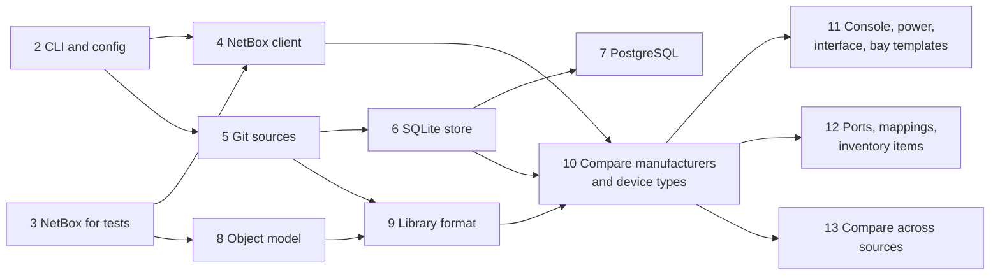

# Roadmap

How the [architecture](architecture.md) gets built. Each milestone is a slice that works end to end, and each step is one pull request. Update this file in the PR that completes a step or changes the plan.

## Milestone 1: list and compare manufacturers and device types

From the command line, point TrueUp at devicetype-library and a disposable local NetBox 4.7.2. List the manufacturers and device types the library defines, and see for each one whether NetBox already has it and how it differs, field by field and component by component. When more than one source defines a device type, see every source's definition and NetBox's object side by side. TrueUp writes nothing to NetBox. Sources, snapshots and comparisons are recorded in a database, on SQLite or PostgreSQL.

### Scope

- **In:** one or more Git sources, with definitions of the same object grouped across them. Manufacturers, as objects in their own right derived from the library, and device types with every component template the library uses: console port, console server port, power port, power outlet, interface, front port, rear port (with port mappings), module bay, device bay and inventory item templates.
- **Out:** any write to NetBox, importing and linking, the web UI, overrides, schedules, high availability, source kinds other than Git, module types, module type profiles, rack types and images.

### Done when

- `netbox-trueup-ai list` prints the definitions in a source, and reports files that fail validation with their path, line and reason.
- `netbox-trueup-ai compare` gives each manufacturer's and device type's outcome (candidate, absent or conflict) and, for candidates, every field and component difference, as text or JSON.
- With two sources that define the same device type, `compare` shows both definitions and NetBox's object side by side, field by field.
- A parity test imports a sample of library files through NetBox's own YAML import and then compares them, with no differences. Changing a field or a component in NetBox makes exactly that difference appear.
- No code path writes to NetBox. The client has no write methods, and tests seed NetBox through a separate helper.
- The latest comparison of each definition is recorded, and the storage tests pass on both SQLite and PostgreSQL.
- `make check` and the integration tests pass in CI.

### Steps

Steps not connected in the graph can run in parallel. Each step updates the docs it affects, and adds dependencies to [tooling.md](tooling.md) with the reason in its PR description.

1. **`docs: add architecture, roadmap and ADRs 0006-0017`.** Done in #2. This plan, the architecture, and the ADRs it rests on.

2. **`feat(cli): add command tree, configuration and logging`.** Done in #3.
   - A cobra root command with `version`, and `config show`, which prints the effective settings with where each came from and secrets redacted.
   - koanf layering as in [ADR 0012](adr/0012-layered-configuration.md): flags, `TRUEUP_` environment variables, a YAML file and defaults, with `_file` companions for secrets.
   - slog output as text or JSON.
   - ADR: CLI conventions (command names, exit codes, `--output json`).
   - New dependencies: cobra, koanf.
   - Fits here from the backlog: the Claude Code hook that formats Go after edits.

3. **`test: run a disposable NetBox 4.7.2 for integration tests`.** Done in #4.
   - testcontainers-go starts NetBox 4.7.2 from netbox-docker's image, with PostgreSQL and Valkey (netbox-docker's Redis), all pinned by digest, and provisions a v2 token through NetBox's token provisioning endpoint.
   - `make netbox-up` and `make netbox-down` start the same stack with Docker Compose for manual testing. One Compose file, `internal/netboxtest/compose.yaml`, defines it for both.
   - Integration tests carry the `integration` build tag, stay out of `make test`, and run with `make test-integration` in the "Integration tests" CI job. Making that job a required check is a ruleset change for the maintainer.
   - New test-only dependency: testcontainers-go.

4. **`feat(netbox): add a read-only REST client`.** Done in #7.
   - `internal/netbox`, on `net/http` alone: a version check that accepts NetBox 4.7.x only, v2 token authentication with a warning for v1 tokens, cursor pagination, filtered listings across many parents, timeouts, a cap on concurrent requests, retries for reads, response size limits and a custom CA bundle. No write methods.
   - `netbox-trueup-ai netbox check` connects, checks the version, and confirms the token can read every object type milestone 1 needs, exiting with 4 if it can't.
   - New settings: `netbox.ca_bundle`, `netbox.timeout`, `netbox.max_requests`, `netbox.retries` and `netbox.max_response_size`.
   - Integration tests against the NetBox from step 3, seeded through `netboxtest.Post`, with a restricted user's token for the permission check. Packages with integration tests now run one at a time.
   - [ADR 0019](adr/0019-own-netbox-rest-client.md): our own NetBox REST client, closing the spike in tooling.md §3.1.

5. **`feat(source): fetch Git sources and read files at a commit`.** Done in #8.
   - `internal/source`, the source kind interface that later kinds implement: snapshots of a version, listing each file's path, size and SHA-256, with names checked and paths confined, include and exclude patterns, and limits on file size and count, applied before anything is parsed. `internal/glob` matches patterns with `**`.
   - `internal/source/git`, the Git kind on go-git v6: the ref resolved to a commit, then a shallow, single-branch, bare clone into `<data_dir>/cache/sources/<name>/`, filtered to leave out files larger than `max_file_size`, made afresh when the commit changes and skipped when it doesn't. The commit's tree is read from the object store, never checked out. `https` only, with TLS verified, no redirects, and limits on fetch time, disk and objects.
   - `netbox-trueup-ai source fetch`, which reports each source's version, file count and skipped files, and exits 4 when some sources fail.
   - Fetching devicetype-library measured: 871 MB unfiltered, 489 MB at the default 1 MiB limit, 64 MB at 128 KiB, in 70 MiB of memory with v6 against 298 MiB with v5.
   - New source fields: `max_file_size`, `max_files`, `fetch_timeout` and `max_fetch_size`.
   - [ADR 0020](adr/0020-git-sources-with-go-git.md): Git sources with go-git v6, leaving out files larger than the limit.
   - New dependency: go-git v6.0.0-beta.1, with go-billy v6.

6. **`feat(store): set up SQLite with migrations and generated queries`.** Done in #9.
   - `internal/store`, the storage interface that each engine implements in a package of its own, with `internal/store/engine` choosing one from `database.url` and `internal/store/storetest` holding the tests every engine runs.
   - `internal/store/sqlite` on modernc.org/sqlite: one file, `<data_dir>/netbox-trueup-ai.db` unless a `sqlite:` URL names another, created readable by its owner only, in WAL mode with foreign keys enforced, a busy timeout and every commit synced, and times in UTC.
   - goose migrations embedded in the binary, forward only, applied when a command that uses the database opens it, under an operating system lock on a file beside it. A schema newer than the binary knows is refused. sqlc compiles the queries, and `make generate-check`, a step in CI's "Lint and scan" job, fails when the committed code differs.
   - First tables: sources and their latest snapshots. `source fetch` records each fetch, failed ones included, with its time, version, file list and skipped entries, one transaction each, and removes the records of sources no longer configured. A PostgreSQL URL is a configuration error until step 7.
   - `netbox-trueup-ai migrate`, which reports the schema's version before and after and the migrations applied.
   - The Claude Code hook that blocks edits to generated files, and the `db-change` project skill.
   - [ADR 0021](adr/0021-forward-only-migrations-when-opening.md): migrate the database forward only, when a command opens it.
   - New dependencies: modernc.org/sqlite v1.60.1, goose v3.29.0 and golang.org/x/sys for file locks, plus sqlc 1.31.1 as a pinned tool.

7. **`feat(store): add PostgreSQL`.**
   - pgx, with PostgreSQL migrations and queries. The storage test suite runs on both engines, PostgreSQL through testcontainers.
   - Done now, while there are few queries, so every later schema change covers both engines from the start.
   - New dependency: pgx.

8. **`feat(model): add the object model and device type specs`.**
   - Generic objects, values and specs ([ADR 0008](adr/0008-describe-object-types-with-specs.md)), with specs for manufacturers and device type fields, citing NetBox's source.
   - A contract test against the OpenAPI schema of the NetBox from step 3.
   - ADR: how specs are checked against the schema, closing the kin-openapi spike.
   - The `netbox-parity` project skill.

9. **`feat(format): read device types from devicetype-library`.**
   - YAML parsing with limits and duplicate-key rejection, validation against the library's schemas from the same snapshot, and mapping to definitions: device type fields, the manufacturer reference, and a manufacturer definition for each manufacturer the library names, with its slug made the way NetBox's UI makes one. Library-only keys are kept as metadata.
   - `netbox-trueup-ai list`.
   - Test fixtures copied from the library (CC0 licensed), and fuzz tests for parsing.
   - New dependencies: go.yaml.in/yaml/v3, santhosh-tekuri/jsonschema.

10. **`feat(compare): compare manufacturers and device types with NetBox`.**
    - Matching by NetBox's uniqueness rules (candidate, absent, conflict), normalization, and the side-by-side comparison structure, here with two columns: the library's definition and NetBox's object.
    - `netbox-trueup-ai compare` with text and JSON output. The latest comparison of each definition is recorded in the database.
    - The parity test through NetBox's own YAML import.
    - A usage guide for `list` and `compare`.
    - This is the first end-to-end slice, covering manufacturers and device type fields only.

11. **`feat(compare): compare console, power, interface and bay templates`.**
    - Specs, mapping and child differences for console port, console server port, power port, power outlet (with its power port reference), interface, module bay and device bay templates.

12. **`feat(compare): compare ports, port mappings and inventory items`.**
    - Rear and front port templates, with mappings folded into front ports, and inventory item templates as a tree with their component references.
    - The `add-netbox-object` project skill, now that several object types show the pattern.

13. **`feat(compare): compare definitions across sources`.**
    - Definitions from every configured source grouped into objects by NetBox's uniqueness rules, with a conflict reported when one source defines an object twice.
    - `compare` shows a column for each source that defines an object, plus NetBox, in text and JSON.
    - Tests with two Git sources that agree on some fields and disagree on others.

## Milestone 2: import and sync manufacturers and device types

From the command line, import a selection of definitions and sync them to a local NetBox 4.7.2.

- **Import and links.** `import` links candidates and records requests to create absent objects, making the chosen source's definition primary. The primary can be switched to another source's definition, or to NetBox to leave the object as it is, and `unlink` stops management. Compare reports linked, orphaned and missing outcomes.
- **Writes in the NetBox client.** `POST` and `PATCH` with `If-Match` and `changelog_message`, bulk creates, and NetBox 4.7's per-object bulk errors.
- **Plans.** The planner, dependency order, missing manufacturers imported in the same plan, and stored plans with ETags. A `plan` command.
- **Apply.** The executor, the apply lock, stale plans and sync history. `apply` and `history` commands.
- **Change references.** `plan --change` attaches the ticket for the change, by URL or ticket number, recorded with the plan, in the audit log and in each write's changelog message.
- **NetBox branches.** A plan can be written into a new NetBox branch and merged once approved, with merge jobs followed to the end and conflicts reported, never acknowledged ([ADR 0017](adr/0017-netbox-branches.md)). Where netbox-changes is installed, TrueUp opens a change request for each branch, and NetBox's decision is final. The test NetBox gains a variant with netbox-branching 1.2 installed, and one with netbox-changes as well.
- **Audit log.** Every import, choice, plan, approval and write recorded with the operating system user who ran the command ([ADR 0014](adr/0014-audit-every-action.md)), and changelog messages in NetBox that name the approver. An `audit` command.
- **Permission set.** `permissions export` writes the NetBox permissions the token needs, including the branching plugin's.
- **Parity.** Device types created by TrueUp match those created by NetBox's own import.

Done when, starting from a fresh local NetBox, you can import a selection of library device types where some already exist and some don't, apply the plan, and then compare shows everything in sync. The audit log shows who imported, approved and applied each change. Planning again produces an empty plan. Editing a linked object in NetBox, or a new version of the source, between planning and applying makes the plan stale instead of writing anything. The same plan can go through a NetBox branch instead: written into the branch, visible in NetBox's branch diff, and merged.

## Later milestones

Proposed order, to be refined when milestone 2 is done.

- **M3, web UI.** Browse sources and objects. Each object's page compares every source's definition and NetBox's object side by side, with a live edit area compared against them as you type. Import, choose the primary definition, and review and apply plans. Sign-in with OpenID Connect single sign-on or local accounts, built-in roles mapped from the identity provider's groups, and the audit log in the UI.
- **M4, access and change management.** Permissions scoped to sources, object types and selections; approval policies, off by default, with separation of duties and required change references; SAML sign-in; and SCIM provisioning ([ADR 0015](adr/0015-sign-in-and-provisioning.md), [ADR 0016](adr/0016-permissions-and-approval-policies.md)).
- **M5, overrides and injected values.** Tick Override on any field to take it from another source, from NetBox, or from the live edit, and save live edits as overrides. Rules that inject values across many objects.
- **M6, server operations.** Schedules, high availability with leader election, metrics for Prometheus and OpenTelemetry, traces, and running as a systemd unit or Windows service.
- **M7, events and integrations.** Inbound webhooks from Git hosts and NetBox that trigger fetches and comparisons, outbound webhooks when something syncs, and streaming the audit log to log pipelines, OpenTelemetry or a SIEM.
- **M8, more object types.** Module types and module type profiles, module bay types, rack types, and device type and module images, all from devicetype-library.
- **M9, more source kinds.** HTTP and local file sources, then other kinds as they are needed.
- **M10, beyond the library.** A format for other NetBox objects, and exporting NetBox objects to a writable Git source.
- **Further out.** Carrying device type and module type changes to devices and modules that already exist, which NetBox itself never does. Writing to NetBox with each user's own token, so NetBox attributes changes to them. Checking change references against the organization's change management system.

Release and packaging (release-please, GoReleaser, container image, Helm chart, dev container) is a separate track, done before the first release. When to make that release is the maintainer's call.

## Backlog outside the milestones

- Claude Code hooks from tooling.md §1.5 that aren't placed in a step above: block commits on `main`, force-pushes and `--no-verify`, and block reads of secret files.
- Repository settings: turn off the Wiki and Projects tabs, and restrict which Actions may run.
