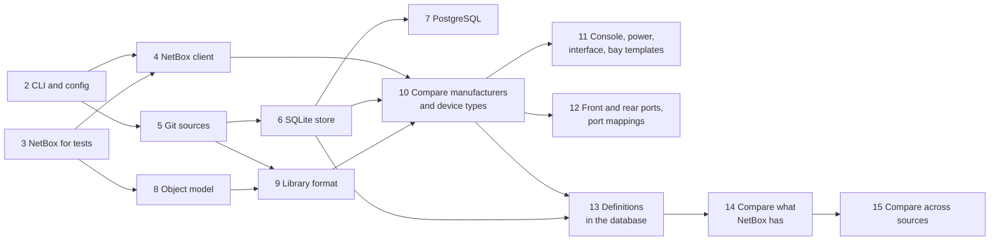
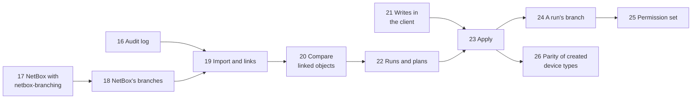

# Roadmap

How the [architecture](architecture.md) gets built. Each milestone is a slice that works end to end, and each step is one pull request. Update this file in the PR that completes a step or changes the plan.

## Milestone 1: list and compare manufacturers and device types

From the command line, point TrueUp at devicetype-library and a disposable local NetBox 4.7.2. List and search the manufacturers and device types the library defines, and see, for those NetBox has or that you choose, how NetBox's differ, field by field and component by component. When more than one source defines a device type, see every source's definition and NetBox's object side by side. TrueUp writes nothing to NetBox. Sources, snapshots, their definitions and comparisons are recorded in a database, on SQLite or PostgreSQL, where commands, and later the web UI, read definitions without reading the sources' files.

### Scope

- **In:** one or more Git sources, with definitions of the same object grouped across them. Manufacturers, as objects in their own right derived from the library, and device types with every component template the library uses: console port, console server port, power port, power outlet, interface, front port, rear port (with port mappings), module bay and device bay templates.
- **Out:** any write to NetBox, importing and linking, the web UI, overrides, schedules, high availability, source kinds other than Git, module types, module type profiles, rack types and images. Inventory item templates are out for good: NetBox has deprecated them in favour of modules ([ADR 0028](adr/0028-no-inventory-item-templates.md)).

### Done when

- `netbox-trueup-ai list` prints the definitions in a source, from the database, finds them by manufacturer, model or part number with `--search`, and reports files that fail validation with their path, line and reason.
- `netbox-trueup-ai compare` compares what NetBox has, or the manufacturers and device types named: each one's outcome (candidate, absent or conflict) and, for candidates, every field and component difference, as text or JSON.
- With two sources that define the same device type, `compare` shows both definitions and NetBox's object side by side, field by field.
- A parity test imports a sample of library files through NetBox's own YAML import and then compares them, with no differences. Changing a field or a component in NetBox makes exactly that difference appear.
- No code path writes to NetBox. The client has no write methods, and tests seed NetBox through a separate helper.
- Each source's definitions are loaded into the database once per version, and the latest comparison of each definition compared is recorded. The storage tests pass on both SQLite and PostgreSQL.
- `make check` and the integration tests pass in CI.

### Steps

Steps not connected in the graph can run in parallel. Each step updates the docs it affects, and adds dependencies to [tooling.md](tooling.md) with the reason in its PR description.

1. **`docs: add architecture, roadmap and ADRs 0006-0017`.** Done in #2. This plan, the architecture, and the ADRs it rests on.

2. **`feat(cli): add command tree, configuration and logging`.** Done in #3.
   - A cobra root command with `version`, and `config show`, which prints the effective settings with where each came from and secrets redacted.
   - koanf layering as in [ADR 0012](adr/0012-layered-configuration.md): flags, `TRUEUP_` environment variables, a YAML file and defaults, with `_file` companions for secrets.
   - slog output as text or JSON.
   - ADR: CLI conventions (command names, exit codes, `--output json`).
   - New dependencies: cobra, koanf.
   - Fits here from the backlog: the Claude Code hook that formats Go after edits.

3. **`test: run a disposable NetBox 4.7.2 for integration tests`.** Done in #4.
   - testcontainers-go starts NetBox 4.7.2 from netbox-docker's image, with PostgreSQL and Valkey (netbox-docker's Redis), all pinned by digest, and provisions a v2 token through NetBox's token provisioning endpoint.
   - `make netbox-up` and `make netbox-down` start the same stack with Docker Compose for manual testing. One Compose file, `internal/netboxtest/compose.yaml`, defines it for both.
   - Integration tests carry the `integration` build tag, stay out of `make test`, and run with `make test-integration` in the "Integration tests" CI job. Making that job a required check is a ruleset change for the maintainer.
   - New test-only dependency: testcontainers-go.

4. **`feat(netbox): add a read-only REST client`.** Done in #7.
   - `internal/netbox`, on `net/http` alone: a version check that accepts NetBox 4.7.x only, v2 token authentication with a warning for v1 tokens, cursor pagination, filtered listings across many parents, timeouts, a cap on concurrent requests, retries for reads, response size limits and a custom CA bundle. No write methods.
   - `netbox-trueup-ai netbox check` connects, checks the version, and confirms the token can read every object type milestone 1 needs, exiting with 4 if it can't.
   - New settings: `netbox.ca_bundle`, `netbox.timeout`, `netbox.max_requests`, `netbox.retries` and `netbox.max_response_size`.
   - Integration tests against the NetBox from step 3, seeded through `netboxtest.Post`, with a restricted user's token for the permission check. Packages with integration tests now run one at a time.
   - [ADR 0019](adr/0019-own-netbox-rest-client.md): our own NetBox REST client, closing the spike in tooling.md §3.1.

5. **`feat(source): fetch Git sources and read files at a commit`.** Done in #8.
   - `internal/source`, the source kind interface that later kinds implement: snapshots of a version, listing each file's path, size and SHA-256, with names checked and paths confined, include and exclude patterns, and limits on file size and count, applied before anything is parsed. `internal/glob` matches patterns with `**`.
   - `internal/source/git`, the Git kind on go-git v6: the ref resolved to a commit, then a shallow, single-branch, bare clone into `<data_dir>/cache/sources/<name>/`, filtered to leave out files larger than `max_file_size`, made afresh when the commit changes and skipped when it doesn't. The commit's tree is read from the object store, never checked out. `https` only, with TLS verified, no redirects, and limits on fetch time, disk and objects.
   - `netbox-trueup-ai source fetch`, which reports each source's version, file count and skipped files, and exits 4 when some sources fail.
   - Fetching devicetype-library measured: 871 MB unfiltered, 489 MB at the default 1 MiB limit, 64 MB at 128 KiB, in 70 MiB of memory with v6 against 298 MiB with v5.
   - New source fields: `max_file_size`, `max_files`, `fetch_timeout` and `max_fetch_size`.
   - [ADR 0020](adr/0020-git-sources-with-go-git.md): Git sources with go-git v6, leaving out files larger than the limit.
   - New dependency: go-git v6.0.0-beta.1, with go-billy v6.

6. **`feat(store): set up SQLite with migrations and generated queries`.** Done in #9.
   - `internal/store`, the storage interface that each engine implements in a package of its own, with `internal/store/engine` choosing one from `database.url` and `internal/store/storetest` holding the tests every engine runs.
   - `internal/store/sqlite` on modernc.org/sqlite: one file, `<data_dir>/netbox-trueup-ai.db` unless a `sqlite:` URL names another, created readable by its owner only, in WAL mode with foreign keys enforced, a busy timeout and every commit synced, and times in UTC.
   - goose migrations embedded in the binary, forward only, applied when a command that uses the database opens it. Each process holds a shared operating system lock on a file beside the database while it has it open, and a migration needs the exclusive one. A schema newer than the binary knows is refused, and so is another application's database. sqlc compiles the queries, and `make generate-check`, a step in CI's "Lint and scan" job, fails when the committed code differs.
   - First tables: sources and their latest snapshots. `source fetch` records each fetch, failed ones included, with its time, version, file list and skipped entries, one transaction each, and removes the records of sources no longer configured. Fetches of one source take turns, under a lock held until the fetch is recorded. A PostgreSQL URL is a configuration error until step 7.
   - `netbox-trueup-ai migrate`, which reports the schema's version before and after and the migrations applied.
   - The Claude Code hook that blocks edits to generated files, and the `db-change` project skill.
   - [ADR 0021](adr/0021-forward-only-migrations-when-opening.md): migrate the database forward only, when a command opens it.
   - New dependencies: modernc.org/sqlite v1.60.1, goose v3.29.0 and golang.org/x/sys for file locks, plus sqlc 1.31.1 as a pinned tool.

7. **`feat(store): add PostgreSQL`.** Done in #10.
   - `internal/store/postgres` on pgx: a `postgres` or `postgresql` URL in `database.url` opens it, with libpq's parameters and environment variables, TLS included (`sslmode`, by default libpq's `prefer`). TrueUp's tables live in a schema of their own, `netbox_trueup_ai`, which TrueUp creates or a database administrator does, marked as TrueUp's by its comment, with every connection's `search_path` pinned to it. A database that isn't UTF-8, or a schema of that name that holds another application's tables, or that another role owns or can put objects in, is refused before anything changes.
   - Migrations with SQLite's numbers and names, in `timestamptz`, `bigint`, `bytea` and `text COLLATE "C"` for sorted columns; queries compiled by sqlc for pgx's own interface, with file lists written by `COPY`.
   - The locks of ADR 0021 as advisory locks: the shared lock held on a connection of the store's own for as long as it is open, the exclusive one to migrate, the gate, a third lock that each pooled connection holds, so that a store whose own connection drops still holds migrations off, and goose's own lock on the connection it migrates through. Poolers must pool by session.
   - The storage suite runs on both engines, PostgreSQL 16 through testcontainers (`internal/store/postgres/pgtest`), in databases that sort by ICU's English rules, so that byte order is proved. Two new shared tests: snapshots read while fetches are recorded, and removing sources while they are recorded. PostgreSQL 15 and later are supported; other releases join the tests once there is a working system.
   - `migrate` reports a PostgreSQL database's location as its hosts, ports and database name, never the user name or password.
   - The `db-change` skill's PostgreSQL steps are required now.
   - [ADR 0022](adr/0022-postgresql-schema-and-advisory-locks.md): a schema of its own, advisory locks, and libpq's connection parameters.
   - New dependency: pgx v5.11.0.

8. **`feat(model): add the object model and device type specs`.** Done in #14.
   - `internal/model`: generic objects, values and specs ([ADR 0008](adr/0008-describe-object-types-with-specs.md)). A decimal is exact, in fixed point, so `1` equals `1.0`; a date has no time zone; and null differs from blank and from a field that isn't set. Specs declare each field's semantics, which `Normalize` and `Validate` apply as NetBox does, trimming with Python's white space and refusing rather than rounding a decimal, and `Check` holds specs to consistency.
   - `internal/model/dcim`: specs for manufacturers and every writable device type field, citing NetBox 4.7.2's source, with both sets of defaults where NetBox's import differs from its REST API (`is_full_depth`, `u_height`), and choice sets an administrator can change through `FIELD_CHOICES` marked. Test-only prototypes of port and inventory item templates show what steps 11 and 12 need: children, port mappings nested in their front port and keyed by position, inventory items as a tree with the gap in their top-level uniqueness, and a generic component reference.
   - A contract test against the OpenAPI schema of the NetBox from step 3: each spec package commits a trimmed snapshot of the schema, which `make test` checks specs against, and the integration tests check it against the live schema byte for byte, along with NetBox's defaults, trimming and validation. `make schema` refreshes snapshots, and choice values are generated from them by `make generate`. Citations are checked against NetBox's source when `make reference` has fetched it.
   - [ADR 0023](adr/0023-check-specs-against-the-schema-with-plain-json.md): the schema is read with plain JSON decoding, closing the kin-openapi spike.
   - The `netbox-parity` project skill.
   - No new dependency.

9. **`feat(format): read device types from devicetype-library`.** Done in #16.
   - `internal/format`: definitions, problems, and a YAML reader that resolves every unquoted value as PyYAML's `SafeLoader` does, since NetBox's own import and the library's tests read files that way, held to PyYAML's answers for 1,954 values. A file is at most 256 KiB, 16 levels deep and 50,000 nodes, in one document; anchors, aliases, merge keys, tags, keys that aren't text and keys given twice are refused. JSON schemas from the source are compiled with every reference outside them refused.
   - `internal/format/devicetypelib`: each device type validated against the library's schemas from the same snapshot, which the format adds to a source's include patterns, then mapped to the device type's spec and validated against it. Device type fields and the manufacturer, by exact name; `is_powered`, `front_image` and `rear_image` kept as metadata; component lists counted, for steps 11 and 12. A manufacturer derived from each name, with the slug NetBox's UI would make (`model.Slugify`, tested against NetBox's own `slugify`), and warnings where two would share a slug, as four pairs in the library do, and where two device types would collide. The whole library, 13,187 files, reads in about 2 seconds with none invalid.
   - `netbox-trueup-ai list`, from the version last fetched or with `--fetch`, as text or JSON, exiting with 4 when a source can't be read or a file is invalid. Definitions aren't stored.
   - 20 device types and the schemas copied from the library (CC0), a golden file of what is read from them, and fuzz tests of the reader and the adapter.
   - [ADR 0024](adr/0024-read-source-files-as-pyyaml-does.md): read source files as PyYAML does, within fixed limits, and validate them with santhosh-tekuri/jsonschema.
   - New dependency: santhosh-tekuri/jsonschema v6.0.3. go.yaml.in/yaml/v3 was already in use.

10. **`feat(compare): compare manufacturers and device types with NetBox`.** Done in #17.
    - `internal/compare`, the comparison engine, with no I/O: each definition is matched to NetBox's objects by every uniqueness rule NetBox enforces, exactly, case included (candidate, absent or conflict), with a derived value, a manufacturer's slug, counting only where TrueUp would create the object, and two NetBox objects that break NetBox's own rules reported as a conflict. The side-by-side result has a column for each version and a row for each field any version sets, with structured paths, cells that tell unset from null, and which rows are managed, derived and differ. Input that isn't as its spec describes it is refused, and the engine is fuzzed against a plain reading of the rules.
    - `model.Spec.DecodeAPI` reads NetBox's answers through the specs, checking every value's shape: choices as `{value, label}`, decimals as numbers, references.
    - `netbox-trueup-ai compare`, with `--manufacturer`, `--fetch` and `--exit-code` (exit 5), as text or JSON. It reads every manufacturer, and the device types of the manufacturers the definitions refer to, asking NetBox for the specs' fields alone.
    - The latest comparison of each definition is recorded, as `compare --output json` prints it, in the new `comparisons` table on both engines, only against the version of the source the database holds.
    - A parity test imports the test library through NetBox's own YAML import, signed in to the disposable NetBox's web UI (`netboxtest.Import`), finds every definition in step, and finds exactly the difference each change in NetBox makes. Run by hand on 400 device types sampled from the whole library, it finds all 527 definitions in step.
    - [docs/usage.md](usage.md), the guide to `list` and `compare`.
    - [ADR 0025](adr/0025-match-by-netbox-uniqueness-rules.md): match by NetBox's uniqueness rules, compare side by side, and record each comparison as `compare` prints it.
    - No new dependency.

11. **`feat(compare): compare console, power, interface and bay templates`.** Done in #24.
    - `internal/model/dcim`: specs of the console port, console server port, power port, power outlet, interface, module bay and device bay templates, as the device type's collections, keyed by name, with a power outlet's power port and an interface's parent and bridge as references within the device type. NetBox's own import fills each field a component leaves out from its form's initial value, which for these templates is the REST API's default, as `TestImportDefaults` checks. The contract test learns that NetBox's schema rebuilds choice fields and nested serializers from the model for requests.
    - `internal/format`: a float such as `maximum_draw: 2.0` reads as a whole number, as Django's `IntegerField` reads it. devicetype-library's lists map to the collections, with the keys NetBox's import form takes; an interface's `bridge` and a console port's `_is_power_source`, which NetBox's import ignores, are read and dropped. A name given twice, or an outlet whose power port the file hasn't got, makes the file invalid, as NetBox's import refuses it. The whole library, 13,187 files, still reads with none invalid.
    - `internal/compare`: children matched by their key within the parent, exactly. A row for each child, its path ending at its key, with NetBox's ID; rows for the fields the definition sets or NetBox holds at other than their defaults. A child NetBox lacks is one difference; one only NetBox has is reported, not managed. Two NetBox children with one key make the device type a conflict. `Matched` lists the device types whose children to read. Fuzzed against a plain reading of the rules, children included.
    - `compare` reads the templates of the device types matched, a collection at a time, all at once, lists templates only NetBox has apart, and streams `--output json`. The whole library against an almost empty NetBox writes 205 MB of JSON, peaking at 634 MB of memory.
    - The parity test also changes an interface's type, an outlet's power port, adds an interface and deletes a console port, each making exactly its difference. Run by hand on 400 device types sampled from the whole library, it finds all 527 definitions in step, templates included.
    - `netboxtest.Get`, for tests that check what NetBox itself made.
    - [ADR 0026](adr/0026-compare-children-by-their-key.md): compare children by their key, with a row for each child, and leave children only NetBox has unmanaged.
    - No new dependency.

12. **`feat(compare): compare front and rear ports and port mappings`.** Done in #25.
    - `internal/model/dcim`: specs of the rear and front port templates, keyed by name, and of port mappings, a front port's nested `rear_ports`, keyed by the front port's position, with the rear port as a reference within the device type by ID. NetBox's import fills a port's or mapping's omitted fields as its REST API does, as `TestImportDefaults` and `TestNestedDefaults` check. A mapping's position is bounded only by NetBox's model and import, since its API runs none of a mapping's checks, so the bound cites `TighterBounds`, which `TestMappingPositionsAgainstNetBox` checks. The step 8 prototypes go, and inventory item templates with them: NetBox has deprecated them, and TrueUp won't support them. The model keeps generic references, shared fields and trees, with their tests, for later object types; `spectest` tests generic references against a schema of its own.
    - `internal/model`: `DecodeAPI` reads a parent's nested collections, as the spec says.
    - `internal/format`: devicetype-library's `front-ports` and `rear-ports` map to their collections, and each item of `port-mappings` folds into its front port, by name. A mapping to a port the file hasn't got, to a rear port position beyond the rear port's, or to a front or rear port position another mapping takes, makes the file invalid, as NetBox's import refuses it; a front port position beyond the front port's, which the import takes, doesn't. A rear port's `_is_power_source` is read and dropped, and `inventory-items` gets a warning, or makes the file invalid where NetBox's import refuses it for not being a list of mappings. Nothing is left unmapped. The whole library, 13,187 files, still reads with none invalid.
    - `internal/compare`: nested collections compared within their parent, their paths going on from it, such as `front_ports["FP1"].rear_ports[1].rear_port`, with no NetBox IDs. A front port NetBox lacks is one difference, its mappings' NetBox cells unset; mappings only NetBox has are reported, not managed. A nested child's reference names a child of any object above it. Fuzzed with mappings.
    - `compare` asks for each front port template's `rear_ports`, and `netbox check` takes its object types from the specs, so `netbox.ReadTypes` goes. The whole library against an almost empty NetBox writes 220 MB of JSON, peaking at 648 MB of memory, against 205 MB and 619 MB before.
    - The parity test also raises a rear port's positions, points a mapping at another rear port, adds a front port and deletes one, each making exactly its difference. Run by hand on 400 device types sampled from the whole library, it finds all 527 definitions in step, and on all 179 files with ports, all 209.
    - The `add-netbox-object` project skill.
    - [ADR 0027](adr/0027-nest-port-mappings-in-their-front-port.md): compare port mappings as children of their front port, keyed by position. [ADR 0028](adr/0028-no-inventory-item-templates.md): don't support inventory item templates.
    - No new dependency.

13. **`feat(source): load each source's definitions into the database`.** Done in #26.
    - Comparing every definition of every source on each run took seconds and gigabytes, and showed thousands of device types NetBox has never had. The web UI needs a search across every source, and an object's comparison across sources and NetBox, each in under a second on a local deployment however many sources there are. So the plan for the end of milestone 1 became three steps: definitions in the database (this one), comparing what NetBox has by default (14), and comparing across sources (15).
    - `internal/store`: `definitions`, `definition_problems` and `definition_loads` tables on both engines ([ADR 0029](adr/0029-keep-a-lookup-table-of-definitions.md)). A load records each definition of a source's latest version as `list --output json` prints it, with its manufacturer, model, slug, part number and file digest, and replaces the last load in one transaction, only if the source's snapshot is still the version read. A definition keeps its internal ID while its source defines the same object in the same file, and IDs are never reused. A search looks in the manufacturer, model and part number, ignoring case, alike on both engines. A failed load is recorded, and keeps what the last load held; a load in progress isn't recorded. The migration is tested to keep what the database held.
    - `internal/model`: `Spec.UnmarshalFields` reads fields back from the JSON TrueUp writes, through the spec. `internal/format`: `MarshalDefinition`, `UnmarshalDefinition` and `EncodeDefinition`, which checks that a definition reads back exactly before it is kept; fuzzing devicetype-library's format checks the same of every file it takes. Formats have a version, recorded as each load's reader, and `TestVersion` fails when what devicetype-library's format makes of its test files changes and its version doesn't.
    - `source fetch` loads each version it fetches, under the source's fetch lock, and reports how many definitions and invalid files it found, or why its files couldn't be read. `list` and `compare` read definitions from the database alone, and load a version the database holds nothing of, or what another version of the format or other settings of the source read, or definitions it can't read back. A version whose load failed is reported as it failed until a fetch, or other settings, try again. `list --search` finds definitions by manufacturer, model or part number.
    - Measured against the whole library: `list` takes 1 second from the database instead of 3 from the files, a search 0.04 seconds, and `compare` 3.8 seconds instead of 6.7 to 12.8, at the same memory and with the same output; two copies of the library take 7.5 seconds instead of 13 to 14. A load takes about 5 seconds and 580 MB, and the database grows by about 32 MB for each copy of the library.
    - No new dependency.

14. **`feat(compare): compare what NetBox has, or what a selection names`.** Done in #27.
    - By default `compare` compares what NetBox has: the definitions that match a NetBox object, or would collide with one, candidates and conflicts. Those NetBox hasn't got are counted, not compared, listed or recorded, and `--exit-code` counts only what was compared ([ADR 0030](adr/0030-compare-what-netbox-has-by-default.md)).
    - A selection compares what it names, absent included: `--manufacturer`, and `--model`, repeatable, which `--manufacturer` narrows, with the manufacturers of the device types it names. Names match as NetBox would store them, and one nothing defines exits 4. `--all` compares everything, and is a usage error beside a selection. JSON output gains a top-level `scope`. Linked objects join the default scope in milestone 2.
    - `internal/compare`: `UniqueValues` cuts a definition down to what matching reads, which a load stores beside it, so that `compare` matches every definition by its unique values, then reads whole only those it compares. `FuzzCompare` holds the cut-down to the whole's match and outcome.
    - `internal/store`: migration 00004 on both engines adds the unique values, and keys comparisons by their definition's ID. A whole run replaces a source's comparisons, a selection only its own, and a load removes those of the definitions it removes; recording checks the load compared as well as the snapshot.
    - The parity test's source holds more than NetBox imports: the default scope compares what was imported, all in step, and only conflicts besides.
    - Measured against the whole library: by default 0.4 seconds and 100 MB with an empty NetBox, 0.5 seconds with 15 manufacturers and 33 device types, and 1.3 seconds with 400 device types, against 3.7 to 4.7 seconds and 680 to 700 MB for comparing everything, which `--all` still takes.
    - No new dependency.

15. **`feat(compare): compare definitions across sources`.** Done in #33.
    - Definitions from every source compared are grouped into objects by type and identity as NetBox would store them, from their unique values; by default an object is compared if any of its definitions matches or collides with NetBox, with all of its definitions ([ADR 0032](adr/0032-compare-definitions-across-sources-as-objects.md)).
    - Each definition keeps its outcome against NetBox; an object is a conflict if one of its definitions is, if a source defines it more than once, or if it clashes with another object, which two do when importing both would leave NetBox holding the same name or slug; otherwise it has its definitions' outcome, and is in step when NetBox and every definition agree. `--exit-code` counts objects.
    - `compare` shows each object with a column for each definition, plus NetBox, in text and JSON, which gains `counts`, `duplicated_in`, `clashes`, and each definition's own outcome in its column. Each definition's comparison is recorded alone, as before, and an object is built by merging them (`compare.Objects`), so the web UI can build it from records.
    - Tests with two Git sources that agree on some fields and disagree on others, a source defining a device type twice, a clash between sources, and a source loaded again mid-run; `FuzzCompare` with up to three sources, held to plain oracles for grouping, clashes, outcomes and merged rows; and a second source in the parity test, whose changed slug and added console port are exactly the differences.
    - Measured against the whole library: with one copy, as step 14 within 10%; with two copies, by default 0.7 seconds against an empty NetBox and 0.9 with 15 manufacturers and 33 device types, and `--all` 9 to 9.7 seconds and 1.5 GB, against 7.3 to 8.7 seconds and 1.3 GB, its JSON 265 MB instead of 439 MB. The library beside a source of the 33 device types a NetBox has takes 0.55 seconds.
    - No new dependency.

## Milestone 2: import and sync manufacturers and device types

From the command line, import a selection of definitions and sync them to a local NetBox 4.7.2: straight to main, or, where NetBox has netbox-branching and TrueUp is set to use it, through a branch that a person merges in NetBox ([ADR 0033](adr/0033-runs-against-main-or-a-chosen-branch.md)). Every import, plan and write is recorded with the operating system user who ran it.

### Scope

- **In:** importing and linking manufacturers and device types, with their component templates; runs against main or a branch chosen from NetBox's own list; plans and applying them; change references; the audit log; the permission set TrueUp's token needs; parity of the device types TrueUp creates with those NetBox's own import creates.
- **Out:** deletes, since orphaned objects and components are reported, not removed; overrides (M5), so a link whose primary is NetBox manages nothing yet; approval policies (M4); pruning the audit log; merging branches, which people do in NetBox; NetBox Changes' change requests, which TrueUp doesn't integrate with, though they work on its branches as on any other (ADR 0033).

### Done when

- Starting from a fresh local NetBox, you can import a selection of library device types where some already exist and some don't, plan, apply, and then `compare` shows everything in sync. Planning again produces an empty plan.
- The audit log shows who imported, approved and applied each change.
- Editing a linked object in NetBox, or a new version of the source, between planning and applying makes the plan stale instead of writing anything.
- With branching off, the default, everything goes to main and nothing asks about branches.
- With branching on and main protected, a run picks a branch from NetBox's list, compares in it and writes into it, never into main. Once a person merges the branch in NetBox, TrueUp records the merge, and `compare` against main shows everything in sync. A run abandoned at any stage leaves main as it was.
- Device types TrueUp creates match those NetBox's own import creates from the same files.
- `make check` and the integration tests pass in CI, against a NetBox with netbox-branching as well as one without.

### Steps

Steps 16, 17 and 21 can start at once. Every step works with branching off, the default, and its tests cover both.

- **16. `feat(audit): keep an append-only audit log`.** Done in #36.
  - `internal/audit`, and an `audit_events` table on both engines that triggers keep append-only. Each event says who acted (at the command line, the operating system user found by the process's user ID, never `$USER`, with the host, and sudo's user under sudo), what, when, through what, about what, and with what result, and is recorded in the same transaction as the change it describes.
  - `source fetch` records sources added, reconfigured, moved to a new version and removed.
  - `netbox-trueup-ai audit`, filtered by time, actor, action and source, as text or JSON.
  - ADR 0034: what is audited, and how.

- **17. `test: run a disposable NetBox with netbox-branching`.** Done in #37.
  - An image built on the pinned netbox-docker image, with netbox-branching 1.2.x pinned by hash and configured as the plugin requires, and a worker; a `branching` profile for `make netbox-up` and `netboxtest`, which creates branches and works in them for tests, and the integration tests run against it in CI as well as against the stock NetBox ([ADR 0035](adr/0035-test-against-netbox-with-and-without-branching.md)).
  - No stand-in for a refused merge, since merging is a person's act in NetBox, nor for a protected main, until it is known how deployments protect it (backlog).

- **18. `feat(netbox): find and read NetBox's branches`.** Done in #41.
  - Settings `netbox.branching`, off by default, and `netbox.protect_main`, on by default. The client reads NetBox's installed plugins when it connects: branching on without netbox-branching 1.2.x is an error, and netbox-branching with branching off a warning.
  - `netbox-trueup-ai netbox branches` lists what a run can target: NetBox's ready branches, and main where it is allowed. `netbox check --branch` and `compare --branch` read through a branch named on the command line, with the `X-NetBox-Branch` header on every request but the reads of branches, once the client has checked that the header reaches NetBox. Comparisons are kept for main and each branch apart ([ADR 0036](adr/0036-read-netbox-through-a-branch-named-on-the-command-line.md)).

- **19. `feat(sync): import definitions and link them to NetBox`.**
  - Links (the NetBox object and the primary definition it follows) and import requests, on both engines. `import` takes `compare`'s selection, against a run's target: a candidate is linked, an absent definition requested, and a conflict refused with its reasons. The primary switches to another source's definition, or to NetBox, and `unlink` stops management. Each is audited.

- **20. `feat(compare): compare linked objects`.**
  - A linked object is compared with its NetBox object by ID, with the linked, orphaned and missing outcomes, and linked objects join the default scope.

- **21. `feat(netbox): write through the REST client`.**
  - A write path apart from reads: `POST` of one object or a bulk create, and `PATCH` with `If-Match`, one object at a time, since NetBox checks `If-Match` only there, each with a `changelog_message` within NetBox's 200 characters. Writes are never retried, and uncertain outcomes, 412 answers and NetBox 4.7's per-object bulk errors are reported as such; `?background=true` is never used. `netbox check` reports whether the token may add and change what TrueUp writes.

- **22. `feat(sync): plan runs against main or a branch`.**
  - Runs: a person's work to true-up one target of the NetBox, from the first `plan` against it until the person finishes or abandons it. Abandoning never touches main.
  - The planner, in `internal/sync`: creates for import requests, sending the definition's fields and NetBox's import defaults where they differ from its API's; `PATCH` of the managed fields that differ; dependency order; missing manufacturers imported in the same plan, and objects that need what no source defines blocked; a request whose object has appeared in NetBox linked instead of created.
  - Plans stored with their run, the source versions, file digests and load they used, and the ETag of every object they change. `plan`, and `plan --change` for the change reference. Audited.

- **23. `feat(sync): apply plans`.**
  - The executor writes a plan into its run's target, one apply at a time for each target, and stops at a stale plan (a file it used changed, another reader or settings, or a 412), a failure or an uncertain write, re-reading NetBox rather than retrying. Changelog messages name TrueUp, the plan, the approver, the commit, the change reference and the file. Each write is audited as started and as completed, and recovery completes any left started. A write to main that NetBox refuses gets an error saying that main may be protected, and naming the settings.
  - `apply` and `history`.

- **24. `feat(sync): follow a run's branch, and create and delete branches`.**
  - A run's branch merged in NetBox is recorded, and the objects created in it stay managed in main, with the same IDs; a branch archived or deleted without being merged abandons its run.
  - `netbox.manage_branches`, off by default: TrueUp creates a branch for a run and waits until it is ready, and offers to delete the branches it created once their run is finished or abandoned. The docs say what turning it on involves. Audited.

- **25. `feat(netbox): export the permissions TrueUp's token needs`.**
  - `permissions export` writes the NetBox permissions TrueUp's token needs, from the specs and the settings, as a file NetBox imports: view on what TrueUp reads, add and change on what it writes, and netbox-branching's where branches are used or managed, never NetBox Changes' bypass. A user with only those passes `netbox check` and applies a plan.

- **26. `test(sync): create device types as NetBox's own import does`.**
  - The same files imported through NetBox's own import and applied by TrueUp make the same objects, every field compared, defaults included. Run by hand on 400 device types sampled from the whole library.

## Later milestones

Proposed order, to be refined when milestone 2 is done.

- **M3, web UI.** Browse and search sources and objects, each page in under a second, reading the database. Each object's page compares every source's definition and NetBox's object side by side, with a live edit area compared against them as you type, showing each colour, such as a port's, as a swatch beside its value. Import, choose the primary definition, pick a run's branch from NetBox's list, and review and apply plans. Sign-in with OpenID Connect single sign-on or local accounts, built-in roles mapped from the identity provider's groups, and the audit log in the UI.
- **M4, access and change management.** Permissions scoped to sources, object types and selections; approval policies, off by default, with separation of duties and required change references; SAML sign-in; and SCIM provisioning ([ADR 0015](adr/0015-sign-in-and-provisioning.md), [ADR 0016](adr/0016-permissions-and-approval-policies.md)).
- **M5, overrides and injected values.** Tick Override on any field to take it from another source, from NetBox, or from the live edit, and save live edits as overrides. Rules that inject values across many objects.
- **M6, server operations.** Schedules, high availability with leader election, metrics for Prometheus and OpenTelemetry, traces, and running as a systemd unit or Windows service.
- **M7, events and integrations.** Inbound webhooks from Git hosts and NetBox that trigger fetches and comparisons, outbound webhooks when something syncs, and streaming the audit log to log pipelines, OpenTelemetry or a SIEM.
- **M8, more object types.** Module types and module type profiles, module bay types, rack types, and device type and module images, all from devicetype-library.
- **M9, more source kinds.** HTTP and local file sources, then other kinds as they are needed.
- **M10, beyond the library.** A format for other NetBox objects, and exporting NetBox objects to a writable Git source.
- **Further out.** Carrying device type and module type changes to devices and modules that already exist, which NetBox itself never does. Writing to NetBox with each user's own token, so NetBox attributes changes to them. Checking change references against the organization's change management system.

Release and packaging (release-please, GoReleaser, container image, Helm chart, dev container) is a separate track, done before the first release. When to make that release is the maintainer's call.

## Backlog outside the milestones

- A protected main in the test NetBox. Find out how deployments refuse writes to main made outside a branch (NetBox Changes, an edition's netbox-branching, or something else, since public netbox-branching 1.2.4 has no such setting) and what NetBox answers, then refuse such writes in the `branching` profile for tests that ask for it, and test step 23's error for a write to main that NetBox refuses against it ([ADR 0035](adr/0035-test-against-netbox-with-and-without-branching.md)).

- Claude Code hooks from tooling.md §1.5 that aren't placed in a step above: block commits on `main`, force-pushes and `--no-verify`, and block reads of secret files.
- Repository settings: turn off the Wiki and Projects tabs, and restrict which Actions may run.
